<div align="center">

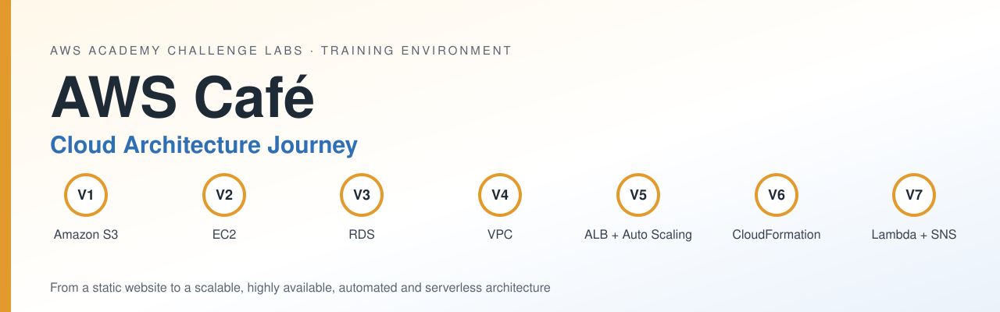

<br>

[](#-scope-and-honesty)
[](#-the-journey-v1--v7)
[](#-how-to-explore-this-repo)
[](AWS-Cafe-Cloud-Architecture.pdf)

**From a static website to a scalable, highly available, automated and serverless architecture.**
<br>
Seven AWS Academy Challenge Labs, one growing café, and every design decision documented with evidence.

[**📘 Read the full book (PDF)**](AWS-Cafe-Cloud-Architecture.pdf) &nbsp;·&nbsp; [**🗺️ The journey**](#-the-journey-v1--v7) &nbsp;·&nbsp; [**🏗️ Final architecture**](#-final-architecture) &nbsp;·&nbsp; [**🧩 Challenges**](#-challenges-i-faced) &nbsp;·&nbsp; [**📂 Repo map**](#-repository-map)

</div>

---

> [!IMPORTANT]
> **Scope.** All seven stages were completed in **AWS Academy Challenge Labs (training environment)**, not in production. Each lab ran in its own lab environment. The lab instructions are not copied here: this repository documents the requirements, my own decisions, my problems and the evidence.

## ⚡ 60-second summary

A fictional café starts with no online presence. Every lab adds **one new business requirement**, and every requirement forces an **architecture change**.

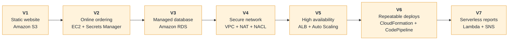

| | |
|---|---|
| 🎯 **What this shows** | Architecture driven by business requirements, not by services in a list |
| 🧱 **Skills** | Storage and DR · compute and AMIs · managed databases · VPC networking · high availability and scaling · infrastructure as code and CI/CD · serverless |
| 🔍 **Proof** | 189 screenshots (account IDs, ARNs and e-mails masked), 17 reference diagrams, one page per stage |
| 🛠️ **Problem solving** | Real failures, what I checked and how each was fixed (see [Challenges](#-challenges-i-faced)) |

---

## 🗺️ The journey (V1 → V7)

| Stage | Business requirement | What I built | Page |
|:--:|---|---|:--:|
| **V1** | Get a small business online | Static website on **Amazon S3** with versioning, lifecycle rules and Cross-Region Replication | [📄](docs/v1-static-website.md) |
| **V2** | Dynamic content and online ordering | Web app and database on **EC2**, settings in **Secrets Manager**, dev and prod from one **AMI** | [📄](docs/v2-dynamic-website.md) |
| **V3** | Less database maintenance, safer data | Database migrated to **Amazon RDS (MariaDB)** in private subnets | [📄](docs/v3-rds-migration.md) |
| **V4** | Improve application security | **VPC** with public and private subnets, bastion host, **NAT gateway**, custom network ACL | [📄](docs/v4-secure-vpc.md) |
| **V5** | Handle more traffic and stay available | **Application Load Balancer** and **Auto Scaling** across two Availability Zones | [📄](docs/v5-scalability-ha.md) |
| **V6** | Identical deployments in any Region | **CloudFormation** templates in **CodeCommit**, deployed by **CodePipeline**, copied to a second Region | [📄](docs/v6-iac-automation.md) |
| **V7** | Daily reports without slowing the site | **Lambda** + **EventBridge** + **SNS** reading from RDS | [📄](docs/v7-serverless-reporting.md) |

### 🔎 Explore each stage

> Click a stage to open it. Every stage has its own page with the full evidence.

<details>
<summary><b>V1 · Static website on Amazon S3</b> — <i>make the café visible online</i></summary>

<br>

**Outcome.** The café went from no online presence to a public website on S3. Versioning protects the content, lifecycle rules manage old versions, and Cross-Region Replication keeps a copy in a second Region.

**Services:** `Amazon S3` · `S3 versioning` · `Lifecycle rules` · `Cross-Region Replication` · `IAM`

**Challenge.** The site returned nothing even with hosting enabled, because *Block all public access* was still on. I turned it off and added a **read-only** (`s3:GetObject`) bucket policy, so the public can view the site but not list, change or delete anything.

<p align="center">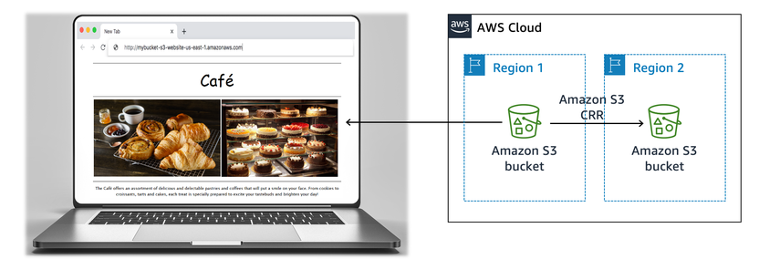<br><sub>Reference: target architecture from the AWS Academy lab.</sub></p>

<table><tr>
<td width="33%">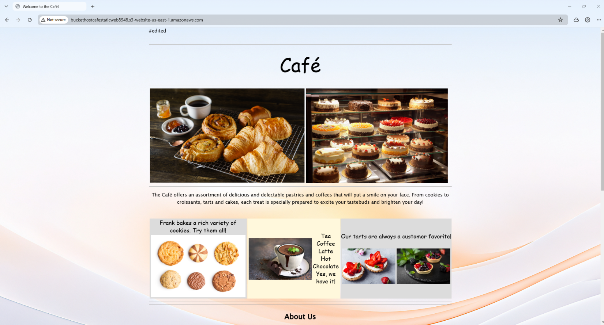<br><sub>Website live on the S3 endpoint</sub></td>
<td width="33%">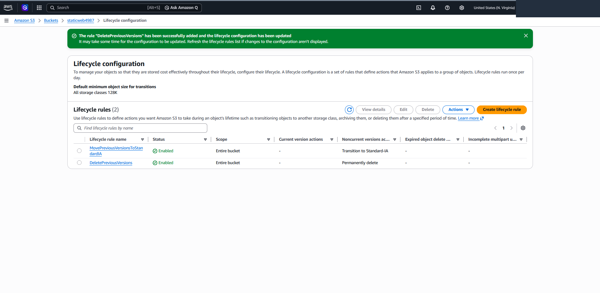<br><sub>Lifecycle rules</sub></td>
<td width="33%">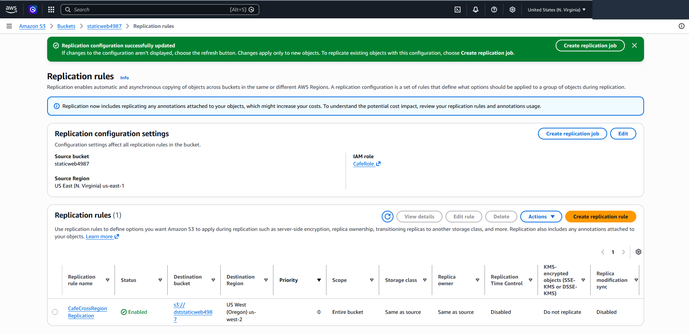<br><sub>Cross-Region Replication rule</sub></td>
</tr></table>

➡️ [Open the full V1 page](docs/v1-static-website.md)
</details>

<details>
<summary><b>V2 · Dynamic website on Amazon EC2</b> — <i>take online orders</i></summary>

<br>

**Outcome.** A working ordering application with its configuration in Secrets Manager. The same application runs in two Regions: dev in N. Virginia and prod in Oregon, both created from one AMI.

**Services:** `Amazon EC2` · `AWS Secrets Manager` · `Amazon Machine Image` · `Security groups` · `IAM role`

**Challenge.** After moving Apache to port 8000 the test page did not load. The security group did not allow TCP 8000, so I added an inbound rule.

<p align="center">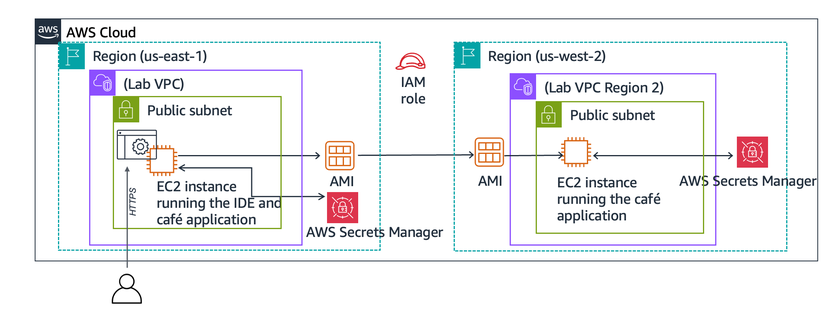<br><sub>Reference: target architecture from the AWS Academy lab.</sub></p>

<table><tr>
<td width="33%">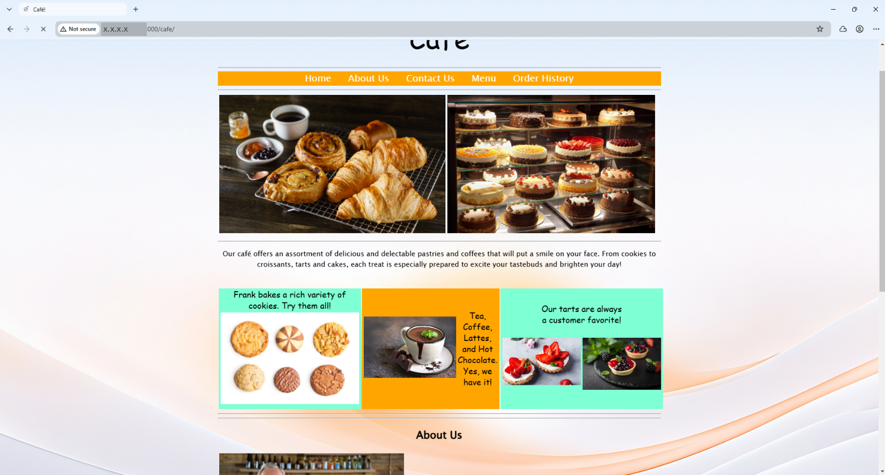<br><sub>Café website live (dev)</sub></td>
<td width="33%">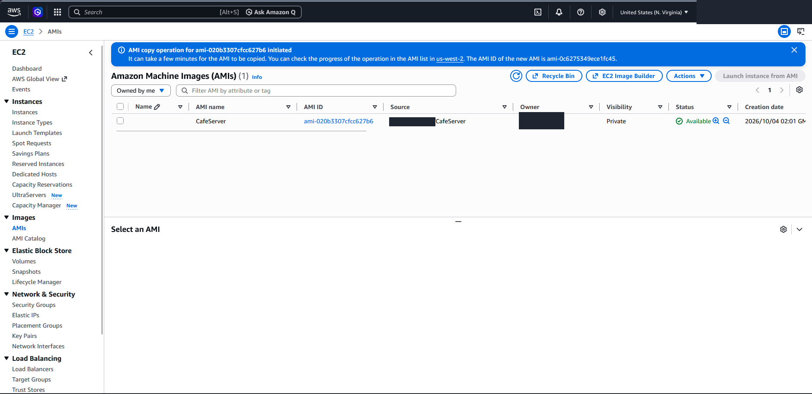<br><sub>AMI available in Oregon</sub></td>
<td width="33%">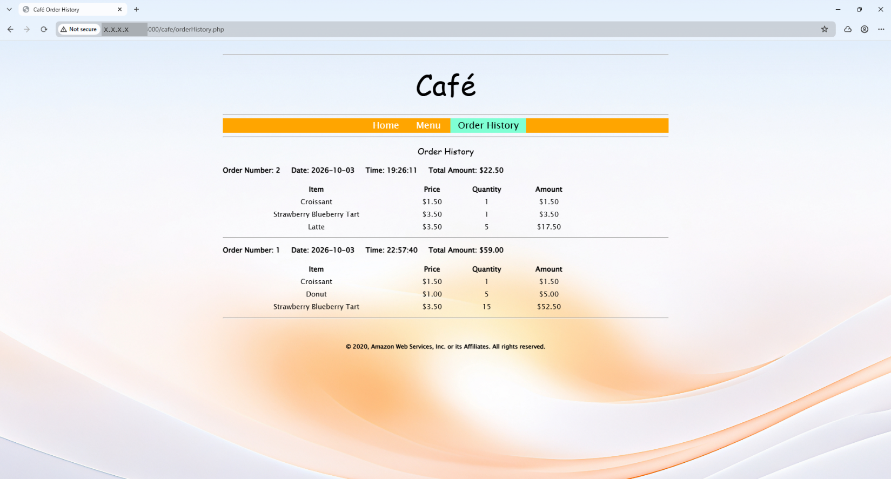<br><sub>Order history on prod</sub></td>
</tr></table>

➡️ [Open the full V2 page](docs/v2-dynamic-website.md)
</details>

<details>
<summary><b>V3 · Database migration to Amazon RDS</b> — <i>less maintenance, safer data</i></summary>

<br>

**Outcome.** Order data now lives in a managed RDS MariaDB instance in private database subnets, reachable only from the application's security group. All 25 existing orders were kept and new orders (order 26) were accepted with no code changes.

**Services:** `Amazon RDS (MariaDB)` · `mysqldump` · `Systems Manager Session Manager` · `Secrets Manager` · `Security groups`

**Challenge.** The first connection from EC2 to RDS failed with `ERROR 2002`. I added an inbound rule for TCP 3306 on the database security group with a **security group as the source** (not an open IP range), confirmed the port with `nmap`, then logged in.

<p align="center">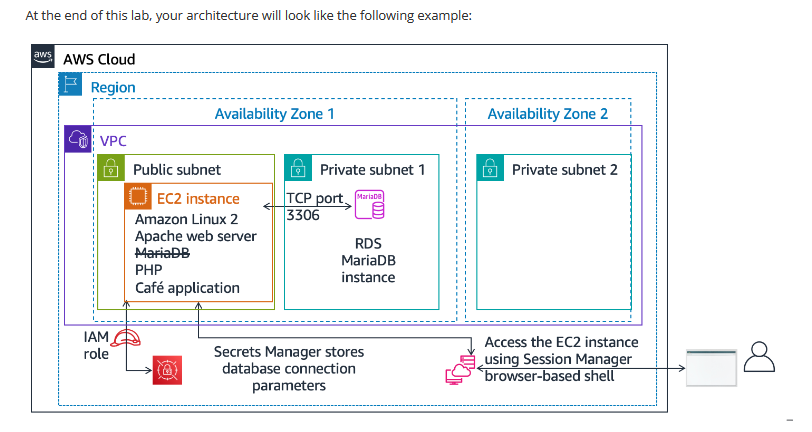<br><sub>Reference: target architecture from the AWS Academy lab.</sub></p>

<table><tr>
<td width="33%">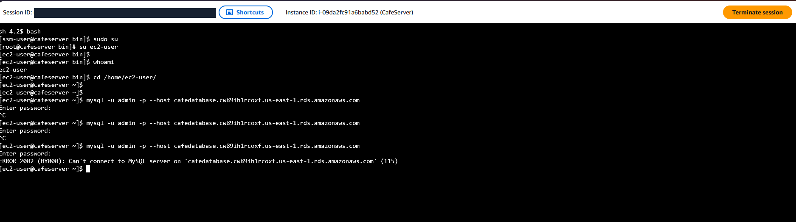<br><sub>The failure: ERROR 2002</sub></td>
<td width="33%">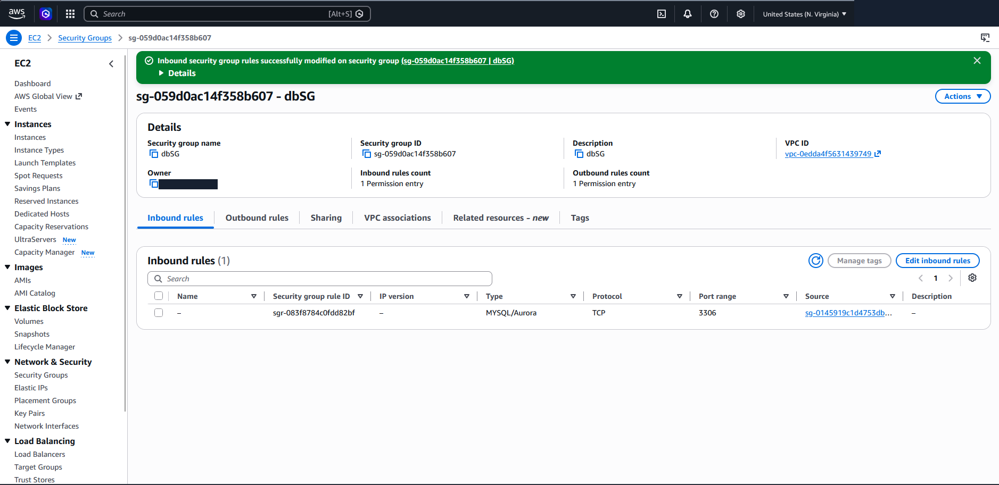<br><sub>The fix: inbound rule on TCP 3306</sub></td>
<td width="33%">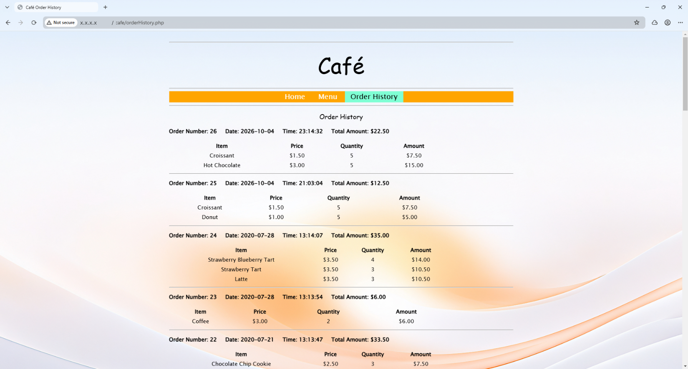<br><sub>Order history after migration</sub></td>
</tr></table>

➡️ [Open the full V3 page](docs/v3-rds-migration.md)
</details>

<details>
<summary><b>V4 · Secure VPC networking</b> — <i>protect the application</i></summary>

<br>

**Outcome.** A VPC with a public tier (bastion host, NAT gateway) and a private tier (private instance). Private resources have no public IP, are reachable only through the bastion, can still reach the internet through the NAT gateway, and sit behind an extra network ACL layer that I tested by blocking and observing traffic.

**Services:** `Amazon VPC` · `Subnets` · `Internet gateway` · `NAT gateway` · `Route tables` · `Security groups` · `Network ACLs`

**Challenges.** SSH to the bastion stopped when my home IP changed. The NAT gateway alone did not give the private instance internet access: it also needed to sit in the public subnet and have a route from the private route table. Network ACL rules depend on order (deny 99 before allow 100) and direction.

<p align="center">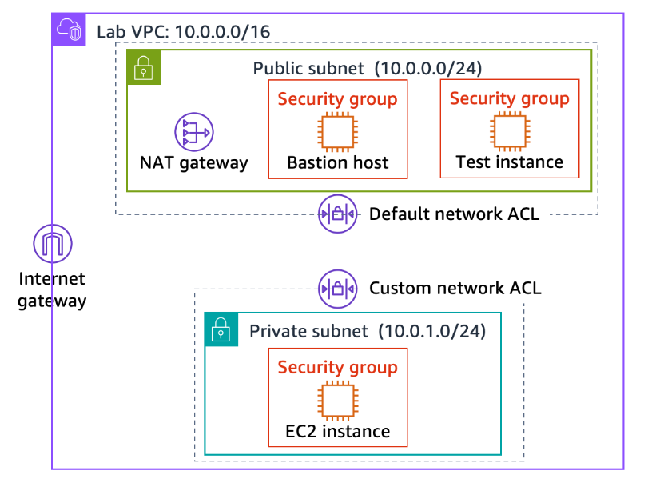<br><sub>Reference: target architecture from the AWS Academy lab.</sub></p>

<table><tr>
<td width="33%">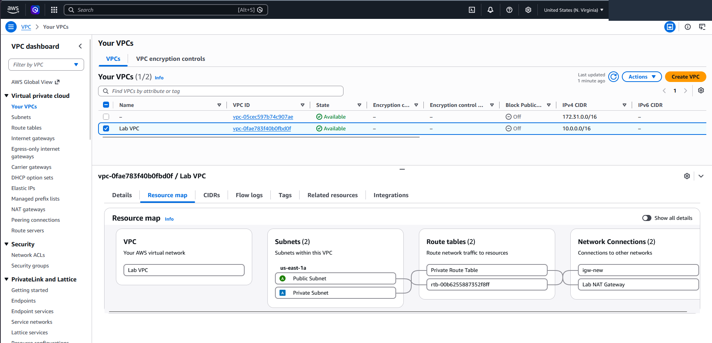<br><sub>VPC resource map</sub></td>
<td width="33%">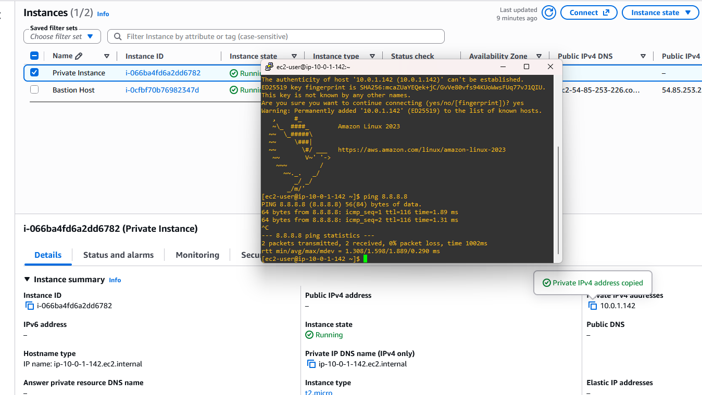<br><sub>Private instance reaches the internet via NAT</sub></td>
<td width="33%">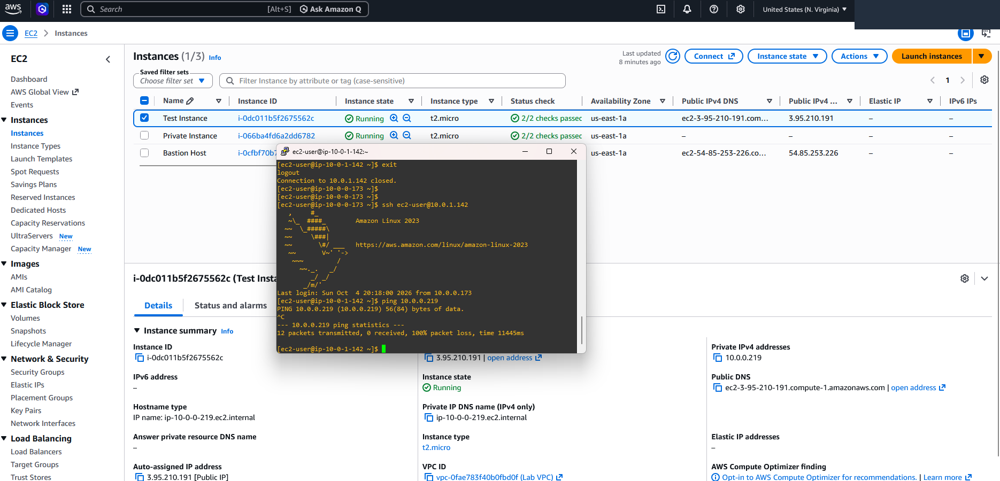<br><sub>Ping blocked by the network ACL</sub></td>
</tr></table>

➡️ [Open the full V4 page](docs/v4-secure-vpc.md)
</details>

<details>
<summary><b>V5 · Scalability and high availability</b> — <i>handle a traffic spike</i></summary>

<br>

**Outcome.** The website runs behind an Application Load Balancer on an Auto Scaling group across two Availability Zones. Under a CPU stress test the group grew from 2 to 6 healthy web servers with no manual action.

**Services:** `Application Load Balancer` · `Target group` · `Launch template` · `Auto Scaling group` · `NAT gateway (one per AZ)` · `CloudWatch`

**Decisions.** Web servers stay in private subnets and only the load balancer is public. One NAT gateway per Availability Zone avoids a single point of failure. Minimum 2 instances (one per AZ), maximum 6 to cap cost. Scaling on average CPU (target 25%).

<p align="center">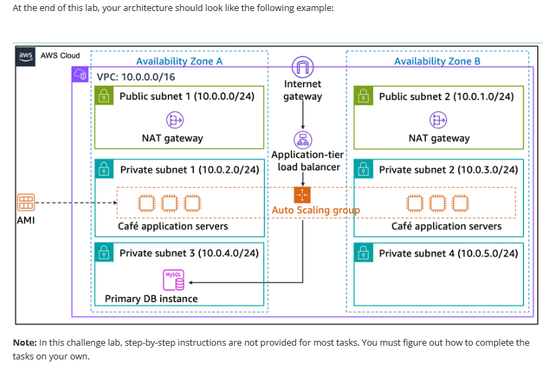<br><sub>Reference: target architecture from the AWS Academy lab.</sub></p>

<table><tr>
<td width="33%">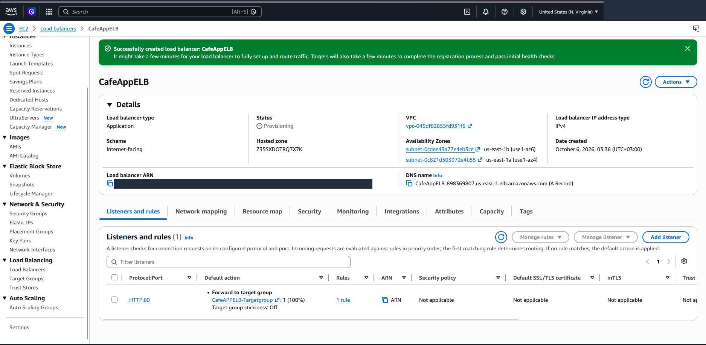<br><sub>Application Load Balancer and listener</sub></td>
<td width="33%">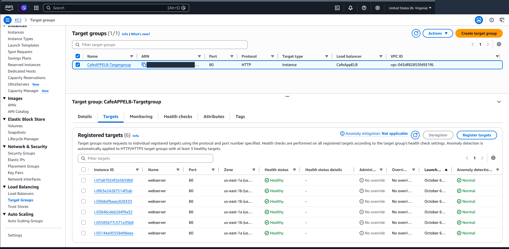<br><sub>Six healthy targets</sub></td>
<td width="33%">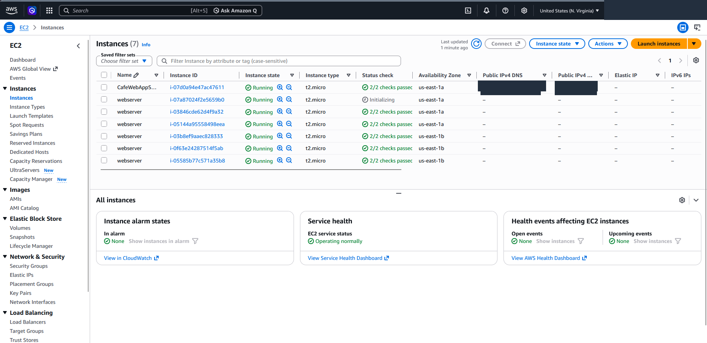<br><sub>Scaled out to six web servers</sub></td>
</tr></table>

➡️ [Open the full V5 page](docs/v5-scalability-ha.md)
</details>

<details>
<summary><b>V6 · Infrastructure automation</b> — <i>the same deployment in any Region</i></summary>

<br>

**Outcome.** The network and web server are defined as CloudFormation templates in CodeCommit and deployed by pipelines on every push. The same templates created a second working copy of the café in us-west-2.

**Services:** `AWS CloudFormation` · `AWS CodeCommit` · `AWS CodePipeline` · `Git` · `Amazon S3` · `Amazon EC2` · `IAM roles`

**Decisions and problems.** Two stacks (network and app) linked through exported outputs, so the application template never hard-codes IDs. Instance type is a parameter and the key pair comes from a Region map, which let the same template run in Oregon. The application pipeline failed on its first run and succeeded when run again; a first template upload failed with `NoSuchBucket` and succeeded on the second attempt.

<p align="center">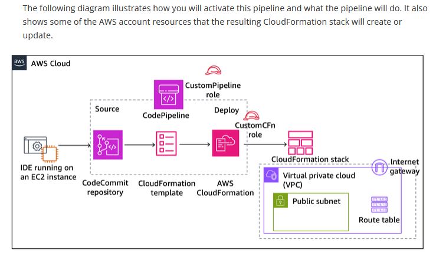<br><sub>Reference: network pipeline flow from the AWS Academy lab.</sub></p>

<table><tr>
<td width="33%">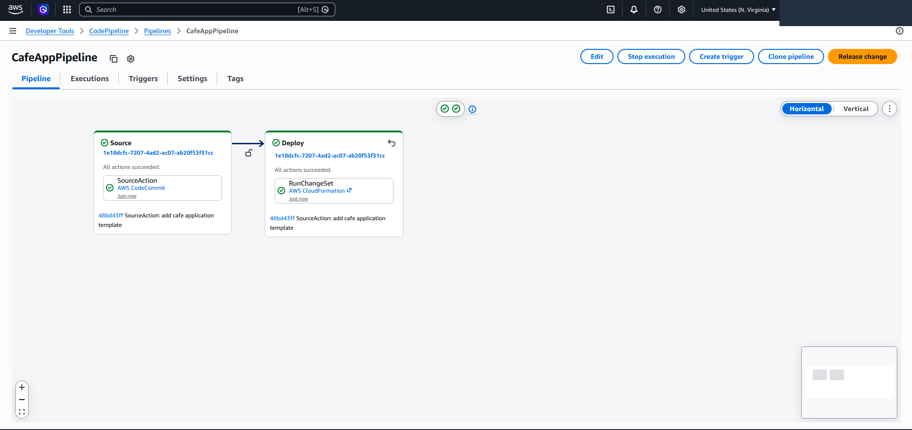<br><sub>Application pipeline succeeded</sub></td>
<td width="33%">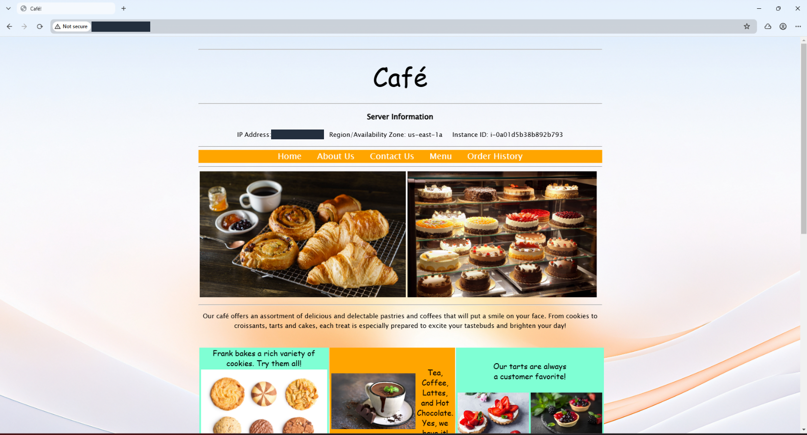<br><sub>Café website in us-east-1</sub></td>
<td width="33%">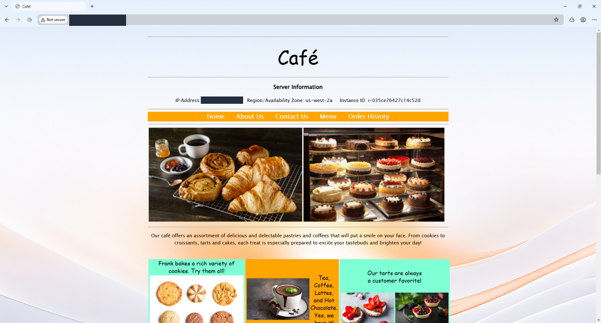<br><sub>Same café in us-west-2</sub></td>
</tr></table>

➡️ [Open the full V6 page](docs/v6-iac-automation.md)
</details>

<details>
<summary><b>V7 · Serverless reporting</b> — <i>daily sales report without slowing the site</i></summary>

<br>

**Outcome.** A scheduled Lambda reads the sales data from RDS through a VPC-attached extractor and e-mails the report through SNS. The report no longer loads the web server, and costs only the seconds it runs.

**Services:** `AWS Lambda` · `Amazon EventBridge` · `Amazon SNS` · `Amazon RDS` · `CloudWatch Logs` · `Security groups` · `IAM`

**Challenge.** The first test failed with *"No body in returned data"*. The extractor log showed the database required TLS (error 3159). I updated the extractor to connect with the RDS CA bundle, and the test then succeeded and the e-mail arrived.

<p align="center">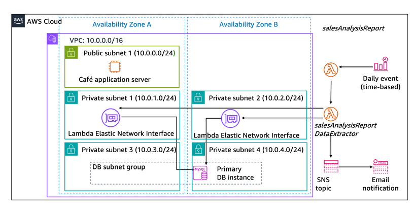<br><sub>Reference: target architecture from the AWS Academy lab.</sub></p>

<table><tr>
<td width="33%">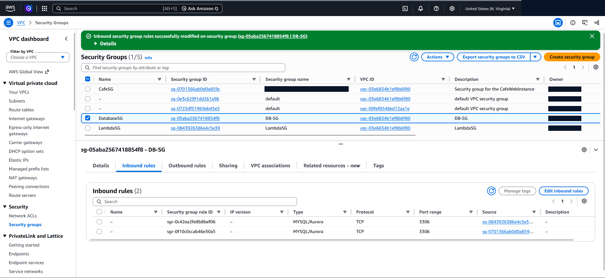<br><sub>Database accepts the café app and the Lambda security group</sub></td>
<td width="33%">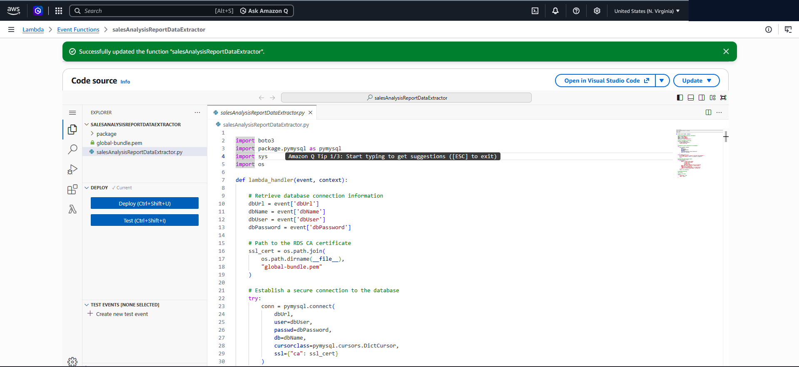<br><sub>The TLS fix</sub></td>
<td width="33%">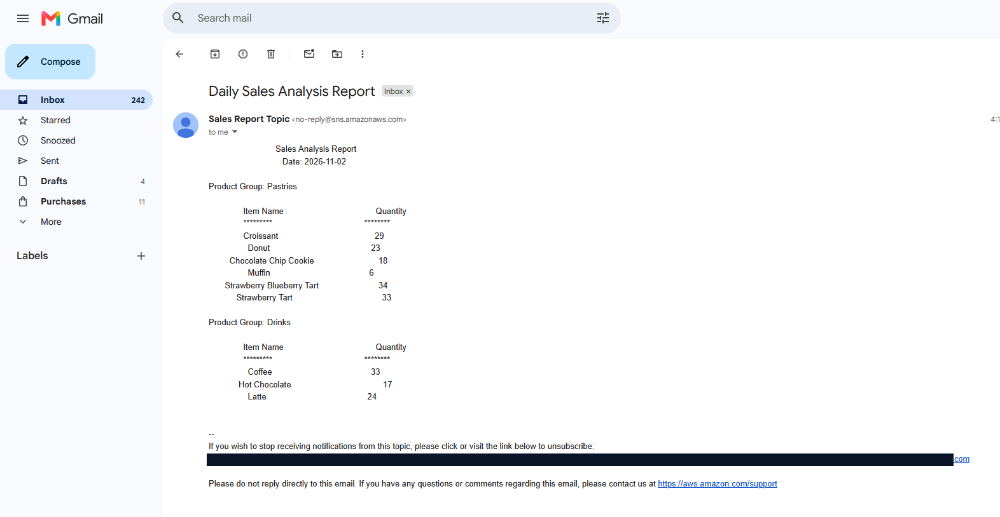<br><sub>The report arriving by e-mail</sub></td>
</tr></table>

➡️ [Open the full V7 page](docs/v7-serverless-reporting.md)
</details>

---

## 🏗️ Final architecture

> [!NOTE]
> This is a **composite view** of how the stages fit together. Each lab ran in its own lab environment, so this shows the combined design, not one environment I deployed end to end.

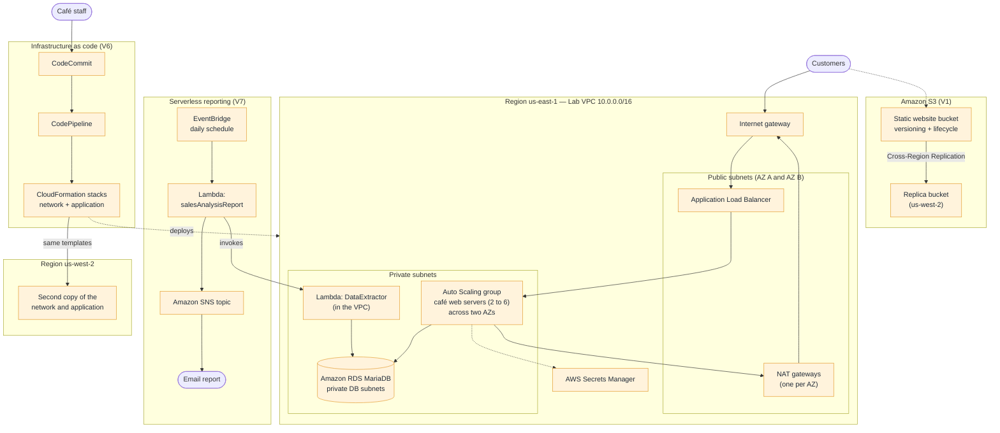

### Business requirement → solution

| Business requirement | Solution | Stage |
|---|---|:--:|
| Be visible online | Static website on Amazon S3 | V1 |
| Protect content and control storage cost | S3 versioning and lifecycle rules | V1 |
| Keep website content if a Region is lost | S3 Cross-Region Replication | V1 |
| Take online orders | Web app and database on EC2, settings in Secrets Manager | V2 |
| Separate dev from prod | AMI copied to us-west-2 and launched as production | V2 |
| Less database maintenance, safer data | Amazon RDS MariaDB in private subnets, access by security group | V3 |
| Keep the application server off the internet | Private subnet, bastion host, NAT gateway, network ACL | V4 |
| Absorb a spike and survive an AZ failure | ALB, Auto Scaling across two AZs, NAT gateway per AZ | V5 |
| Identical deployments in any Region | CloudFormation templates in Git, deployed by CodePipeline | V6 |
| Daily report without slowing the site or paying for an idle server | Lambda, EventBridge schedule, SNS e-mail | V7 |

---

## 🧩 Challenges I faced

> The most useful part of the project. These are real failures from the labs, what I found and what I did.

| Stage | What went wrong | What I found and did |
|:--:|---|---|
| **V1** | Website showed nothing after hosting was enabled | *Block all public access* was still on. Turned it off and added a read-only `s3:GetObject` policy |
| **V1** | Replication did not copy the existing files | Replication applies to new objects only. A one-time job would copy the existing ones |
| **V2** | Test page on port 8000 would not load | The security group did not allow TCP 8000. Added an inbound rule |
| **V3** | First EC2 → RDS connection failed (`ERROR 2002`) | Added an inbound rule on TCP 3306 with a **security group as the source**, confirmed with `nmap` |
| **V4** | SSH to the bastion stopped after my home IP changed | Added a rule for the new IP. Next time: remove the old rule, and prefer Session Manager over open SSH |
| **V4** | NAT gateway alone gave no internet to the private instance | It must be in the public subnet, and the private route table must send `0.0.0.0/0` to it |
| **V4** | Network ACL behaviour was not what I expected | Rules are evaluated by number (deny 99 before allow 100) and ACLs are stateless, so both directions need rules |
| **V6** | Application pipeline failed on its first run | Ran it again and it succeeded. A first template upload also failed (`NoSuchBucket`) and succeeded on retry. Root cause not recorded |
| **V7** | Report test failed with *"No body in returned data"* | The extractor log showed error 3159: the database requires TLS. Updated the extractor to use the RDS CA bundle |

---

## 🧰 Services used

| Service | V1 | V2 | V3 | V4 | V5 | V6 | V7 |
|---|:-:|:-:|:-:|:-:|:-:|:-:|:-:|
| Amazon S3 | ● | | | | | ● | |
| Amazon EC2 and AMI | | ● | ● | ● | ● | ● | |
| AWS Secrets Manager | | ● | ● | | | | |
| Amazon RDS | | | ● | | | | ● |
| Amazon VPC, subnets, routing | | | | ● | ● | ● | ● |
| NAT gateway | | | | ● | ● | | |
| Security groups and network ACLs | | ● | ● | ● | ● | ● | ● |
| Application Load Balancer | | | | | ● | | |
| Auto Scaling | | | | | ● | | |
| AWS CloudFormation | | | | | | ● | |
| CodeCommit and CodePipeline | | | | | | ● | |
| AWS Lambda | | | | | | | ● |
| Amazon SNS | | | | | | | ● |
| Amazon EventBridge | | | | | | | ● |
| Amazon CloudWatch | | | | | ● | | ● |
| IAM | ● | ● | | | | ● | ● |

---

## 📂 How to explore this repo

| If you have… | Do this |
|---|---|
| **2 minutes** | Read this page, then open one stage that interests you and skim *Challenges & Decisions* |
| **10 minutes** | Open [`docs/`](docs) and read the stage pages in order. Each is 1–2 pages and ends with the evidence |
| **A coffee** | Read the [full book (PDF)](AWS-Cafe-Cloud-Architecture.pdf): all stages, all 189 screenshots and the appendices |

### 📂 Repository map

```text
aws-cafe-cloud-architecture/
├── README.md                          ← you are here
├── AWS-Cafe-Cloud-Architecture.pdf    ← the full book
├── docs/                              ← one page per stage (V1 → V7)
│   ├── v1-static-website.md
│   ├── v2-dynamic-website.md
│   ├── v3-rds-migration.md
│   ├── v4-secure-vpc.md
│   ├── v5-scalability-ha.md
│   ├── v6-iac-automation.md
│   └── v7-serverless-reporting.md
├── diagrams/                          ← AWS Academy reference diagrams, by stage
└── evidence/                          ← screenshots, named Vx-Exx-description.png
```

---

## 🔒 Scope and honesty

- **Training environment.** Everything here was done in AWS Academy Challenge Labs.
- **Separate lab environments.** The stages are connected by the story and the design, not by one continuous deployment.
- **My own words.** Lab instructions are not reproduced. The reference diagrams are labelled as coming from the AWS Academy lab.
- **Only what I did.** Where a stage had no recorded problem, the page says so instead of inventing one.
- **Privacy.** Account IDs, ARNs, e-mail addresses and personal paths were masked in the screenshots.

## 🚀 What I would improve next

- Put a CDN with HTTPS in front of the S3 website (the V1 site is HTTP only).
- Run a one-time replication job so the second Region also holds the existing files.
- Replace open SSH with Session Manager or a VPN, and remove stale security group rules.
- Capture the e-mail from the scheduled EventBridge run, not only from the manual test.

---

<div align="center">

**Built while learning the AWS Solutions Architect – Associate course.**

*AWS Café · Cloud Architecture Journey · AWS Academy Challenge Labs (training environment)*

</div>
