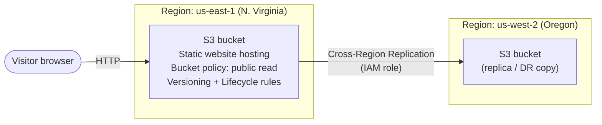
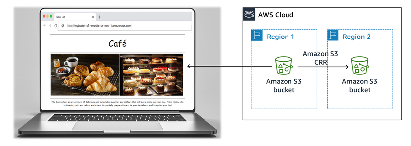
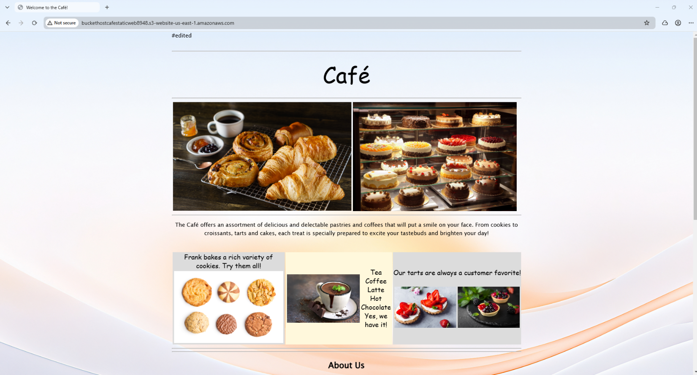
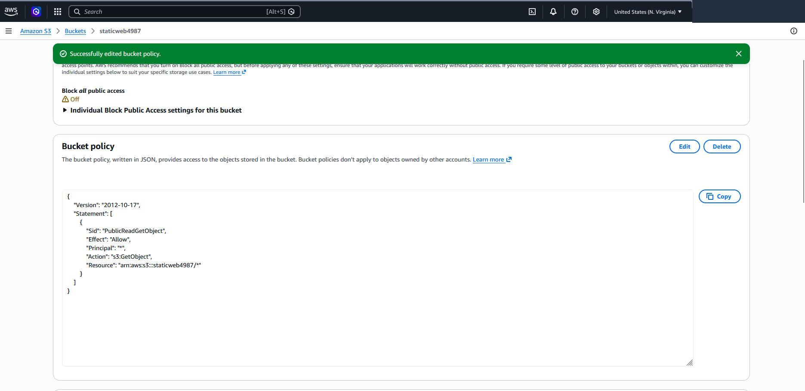
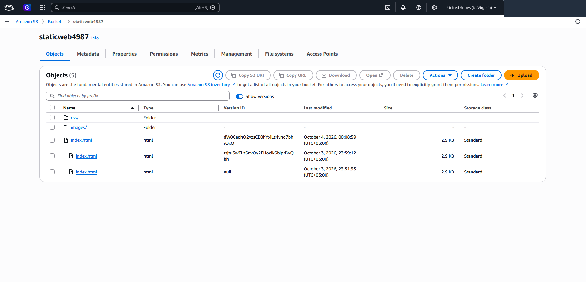
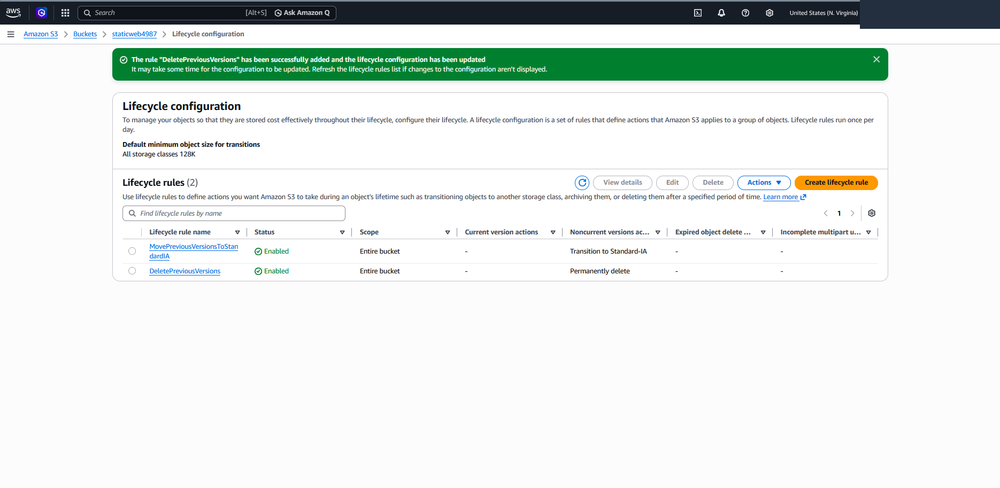
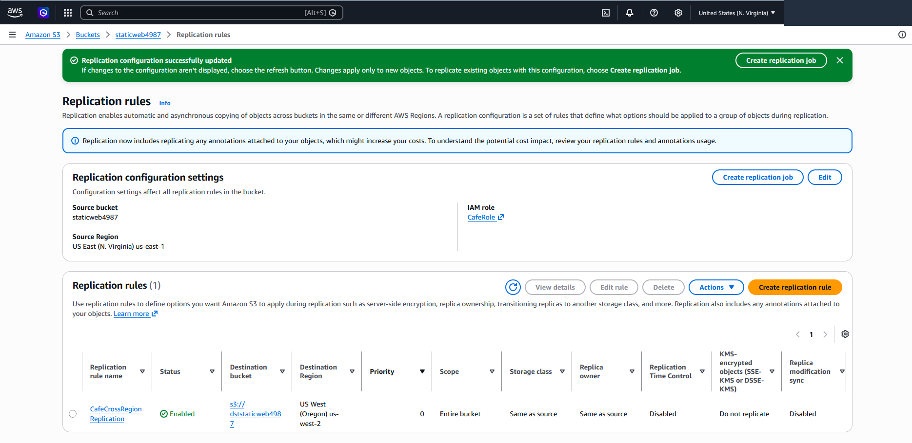
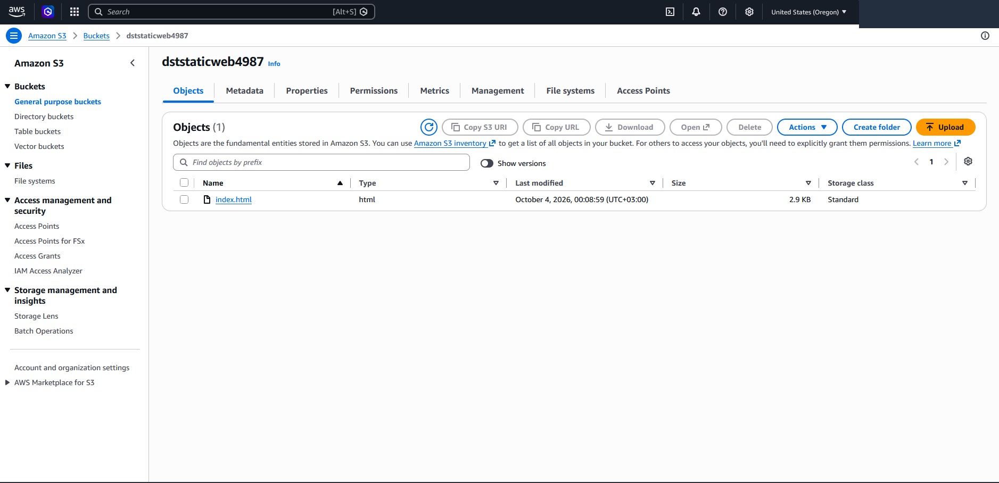

# V1 — Static Website on Amazon S3

> Completed as part of an **AWS Academy Challenge Lab** (training environment).
> Part of the [AWS Café — Cloud Architecture Journey](../README.md): V1 → V7.

---

## Business Requirement

The café is a single-location business that gains customers mostly from foot traffic and word of mouth. It has no web presence and no cloud services yet. The owners want to make the café visible online with a simple website, and to do it in a way that protects the site's content and keeps storage costs under control.

**Lab objectives**

- Host a static website on Amazon S3
- Protect the data with at least one S3 data-protection feature
- Implement a data lifecycle strategy
- Implement a disaster recovery (DR) strategy

---

## Before → After

| | Before | After |
|---|---|---|
| Web presence | None | Public static website served from Amazon S3 |
| Data protection | – | Versioning enabled (previous versions of the page are kept) |
| Storage cost control | – | Lifecycle rules for old versions |
| Disaster recovery | – | Cross-Region Replication to a bucket in another Region |

### Reference architecture

*Reference: target architecture from the AWS Academy lab.*

---

## AWS Services Used

| Service / feature | Role in V1 |
|---|---|
| Amazon S3 | Stores the website files (`index.html`, CSS, images) |
| S3 static website hosting | Serves the bucket content through an S3 website endpoint |
| Bucket policy | Allows public read-only access (`s3:GetObject`) so visitors can load the site |
| S3 Versioning | Keeps previous versions of objects; protects against overwrites |
| S3 Lifecycle rules | Moves old versions to a cheaper class and later deletes them |
| S3 Cross-Region Replication (CRR) | Copies new/changed objects to a bucket in a second Region (DR) |
| IAM role | Lets S3 replicate objects between the two buckets |

---

## Implementation Highlights

1. **Bucket and content.** Created an S3 bucket in `us-east-1` and uploaded the site files: `index.html`, a `css/` folder and an `images/` folder (9 files in the folders plus the HTML page). *(E01)*
2. **Static website hosting.** Enabled static website hosting in the bucket properties and used the bucket's website endpoint to open the site.
3. **Public access.** The site was not reachable at first (see Challenges). I turned off *Block all public access* and added a bucket policy that allows read-only `GetObject` on the bucket's objects. After that the site loaded from the website endpoint. *(E02, E03)*
4. **Versioning (data protection).** Enabled versioning on the bucket. To test it, I edited the page's HTML locally (changed a few background colors), re-uploaded `index.html`, and checked that S3 now kept both the old and the new version. *(E04, E05)*
5. **Lifecycle strategy.** Because versioning makes the bucket grow with every upload, I created two lifecycle rules that apply to the entire bucket and only target *noncurrent* (previous) versions: *(E06, E07, E08)*
   - `MovePreviousVersionsToStandardIA` — transitions previous versions to **Standard-IA** after **30 days**
   - `DeletePreviousVersions` — permanently deletes previous versions after **365 days**
6. **Disaster recovery.** Created a second bucket in **us-west-2 (Oregon)** and configured a replication rule on the source bucket (`CafeCrossRegionReplication`, scope: entire bucket, destination: the Oregon bucket, using an IAM role). I then edited the HTML again, uploaded it to the source bucket, and confirmed that the new version appeared in the destination bucket. *(E09, E10)*

---

## Challenges & Decisions

**1. The website returned no content even though hosting was enabled.**
After enabling static website hosting, opening the website endpoint did not show the site. The cause was that public access was still blocked: *Block all public access* had been turned on when I created the bucket. To add a public-read bucket policy, I first had to turn that setting off, then add a policy that allows only `s3:GetObject` (read-only) on the bucket's objects. I chose read-only access deliberately so the public can view the site but cannot list, modify or delete anything.

**2. Versioning solves one problem and creates another.**
Versioning protects the page from accidental overwrites, but every re-upload adds another stored version, so the bucket grows indefinitely. That is why I paired versioning with lifecycle rules: move old versions to a cheaper storage class, then delete them after a retention period.

**3. Replication does not copy everything automatically.**
After I created the replication rule, the destination bucket contained only the `index.html` that I uploaded afterwards, not the `css/` and `images/` files that already existed. The console message on the rule explains this: replication applies only to **new** objects, and existing objects need a separate replication job. For a real DR setup I would run that job once so the second Region holds a complete copy of the site. *(E09, E10)*

**4. Deleting in the source did not delete in the destination.**
When I deleted an object from the source bucket, it was not removed from the destination bucket. This is consistent with S3's default replication behavior, where delete markers are not replicated unless that option is turned on, and it works in favor of DR: an accidental delete in the main bucket does not wipe out the copy in the second Region. *(Observed during the lab; no screenshot.)*

**5. A design note about the lifecycle transition rule.**
The console warns that objects smaller than 128 KB are not transitioned between storage classes by default. The site's `index.html` is only about 2.9 KB, so in this small site the Standard-IA transition rule would not actually move those versions. The rule is still the right pattern for larger content, but it is worth knowing it has no effect on tiny files unless the minimum-size filter is changed. *(E06)*

---

## Validation & Evidence

### Website is live (E03)

The site loads from the S3 website endpoint in a browser. The browser shows "Not secure" because S3 website endpoints serve HTTP only.

### Public read-only bucket policy (E02)

*Block all public access* is off, and the bucket policy allows only `s3:GetObject`.

### Versioning in action (E05)

Multiple versions of `index.html` after editing and re-uploading the page. The oldest version has a `null` version ID because it was uploaded before versioning was enabled.

### Lifecycle rules (E08)

Two rules are enabled for the entire bucket and act only on noncurrent versions: transition to Standard-IA, and permanent deletion.

### Cross-Region Replication rule (E09)

Replication from `us-east-1` to `us-west-2` (Oregon), entire bucket scope.

### Replica in the second Region (E10)

The edited `index.html` appears in the destination bucket in Oregon, with the same last-modified time as the latest version in the source bucket.

### Evidence index

| ID | What it shows | File |
|---|---|---|
| V1-E01 | Site files uploaded to the bucket (9 files, 0 failed) | `V1-E01-upload-site-files.png` |
| V1-E02 | Public-read bucket policy, Block public access off | `V1-E02-bucket-policy-public-read.png` |
| V1-E03 | Website live at the S3 website endpoint | `V1-E03-website-live.png` |
| V1-E04 | Enabling bucket versioning | `V1-E04-versioning-enabled.png` |
| V1-E05 | Multiple versions of `index.html` | `V1-E05-object-versions.png` |
| V1-E06 | Lifecycle rule: noncurrent versions → Standard-IA after 30 days | `V1-E06-lifecycle-rule-transition-IA.png` |
| V1-E07 | Lifecycle rule: delete noncurrent versions after 365 days | `V1-E07-lifecycle-rule-delete-old-versions.png` |
| V1-E08 | Both lifecycle rules enabled | `V1-E08-lifecycle-rules-list.png` |
| V1-E09 | Cross-Region Replication rule | `V1-E09-replication-rule.png` |
| V1-E10 | Replicated object in the Oregon bucket | `V1-E10-destination-bucket-oregon.png` |

> **Note on evidence.** The V1 lab was run in two sessions, so the screenshots show two sets of bucket names (`buckethostcafestaticweb…` and `staticweb… / dststaticweb…`). Both sessions followed the same steps. Account IDs and user details were redacted from all screenshots.

---

## Outcome

The café went from having no online presence to a public website hosted on Amazon S3. The content is protected with versioning, old versions are managed by lifecycle rules, and a Cross-Region Replication rule keeps a copy of updated content in a second Region.

**Limits of this version (and what the next versions address):** the site is static, so customers cannot place orders (V2 introduces a dynamic application), and it is served over HTTP only. A natural improvement would be to put a CDN with HTTPS in front of the bucket.

➡️ Next: [V2 — Dynamic Website on Amazon EC2](./v2-dynamic-website.md)
