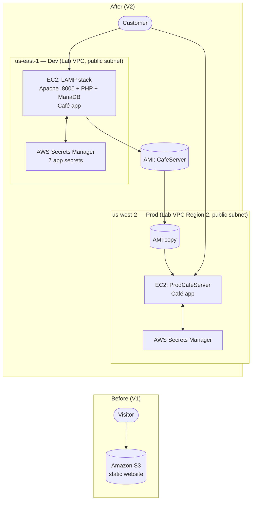
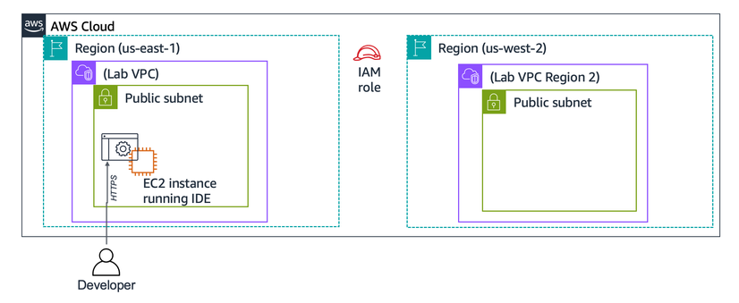
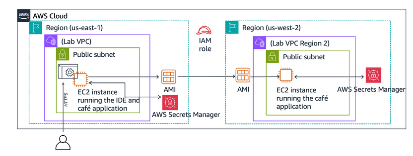

# V2 — Dynamic Website on Amazon EC2

> Completed as part of AWS Academy Challenge Labs (training environment).

## Business Requirement

The café wanted to move beyond a static page and let customers browse a menu and place online orders. That requires a web server, application code, and a database. The café also wanted a separate **development** environment (to test) and a **production** environment in a different Region (for availability).

## Before → After

### Reference architecture

*Reference: starting architecture from the AWS Academy lab.*

*Reference: target architecture from the AWS Academy lab.*

## AWS Services Used

| Service | Role in this stage |
|---|---|
| Amazon EC2 | Hosts the web server, the café application, and the database (dev and prod) |
| Security Groups | Allow inbound TCP 8000 so the site is reachable in the browser |
| AWS Secrets Manager | Stores the application's configuration and DB credentials outside the code |
| Amazon Machine Image (AMI) | Captures the configured dev server so it can be reproduced |
| IAM role (CafeRole) | Attached to the EC2 instances so the app can read its secrets |

## Implementation Highlights

- **Web server:** Connected to the VS Code IDE running on the existing EC2 instance, changed Apache's listening port from 80 to 8000, and enabled it to start on boot. Confirmed PHP was available.
- **Database:** Installed MariaDB on the same instance, started it, and enabled it on boot.
- **Reachability test:** Created a simple `index.html` page and opened the instance's public address on port 8000. It loaded only after I added an inbound rule for TCP 8000 to the instance's security group.
- **Application:** Downloaded and unpacked the café application, the database scripts, and the AWS SDK for PHP.
- **Secrets:** Ran the setup script that creates seven parameters in Secrets Manager (DB user, password, name, URL, plus currency, time zone, and server-info settings). The PHP code reads these at runtime instead of hard-coding them.
- **Database setup:** Set the DB root password, created the café database, and checked the tables from the MySQL client (the products table held 9 menu items).
- **Time zone:** Set the PHP time zone, restarted Apache, then opened the café site and placed a test order.
- **AMI:** Created an AMI named `CafeServer` from the dev instance, copied it to **us-west-2**, and launched `ProdCafeServer` (t2.small) from it in the public subnet of Lab VPC Region 2, with the same IAM role.
- **Secrets in Region 2:** Secrets Manager is regional, so I edited the setup script (target Region and the prod instance's public DNS) to create the secrets in us-west-2, then connected to the prod instance over SSH.

## Challenges & Decisions

<!-- TODO: add any other problems I hit in V2 (only the port 8000 issue is confirmed so far) -->
- **Challenge — the test page would not load.** After moving Apache to port 8000, the page did not open in the browser. I had not taken a screenshot of the failure, but the cause was the instance's security group, which did not allow inbound traffic on that port. **Fix:** I added an inbound rule for TCP 8000 to the security group, and the page loaded (V2-E04, V2-E05).
- **Decision — AMI instead of a manual rebuild:** Capturing the configured server as an AMI means prod is a copy of dev rather than a second hand-built install.
- **Decision — Secrets, not hard-coded credentials:** The app reads its settings from Secrets Manager. Because those secrets are regional, they had to be recreated in the second Region.

## Validation & Evidence

| ID | Caption |
|---|---|
| V2-E04 | Inbound rule for TCP 8000 added to the instance's security group |
| V2-E06 | Seven application secrets created in AWS Secrets Manager |
| V2-E08 | Café home page served from the dev instance in us-east-1 |
| V2-E09 | Test order recorded on the Order History page (dev) |
| V2-E11 | `CafeServer` AMI available, with the copy to us-west-2 started |
| V2-E15 | Café app running on `ProdCafeServer` in us-west-2, with its own order history |

Full screenshot set (V2-E01 … V2-E16) is in `evidence/v2/`.

## Outcome

The café went from a static page to a working ordering application with its configuration kept in Secrets Manager. The same application now runs in two Regions, a dev environment in N. Virginia and a prod environment in Oregon, both created from one AMI.
