# V3 — Database Migration to Amazon RDS

> Completed as part of AWS Academy Challenge Labs (training environment).

## Business Requirement

After the café's online ordering went live (V2), the web server and the database lived on the same EC2 instance, so the owners had to maintain both together. Sofía wanted a database that is easier to maintain and gives durability, scalability and good performance, without losing the order history already stored. The requirement for this stage: **move the café database to a managed service and keep the application working with all existing data.**

## Before → After

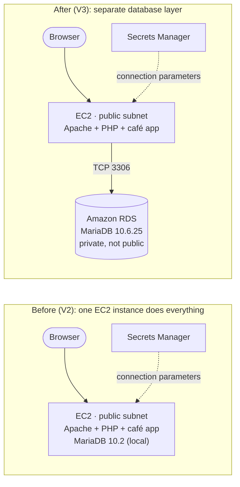

### Reference architecture

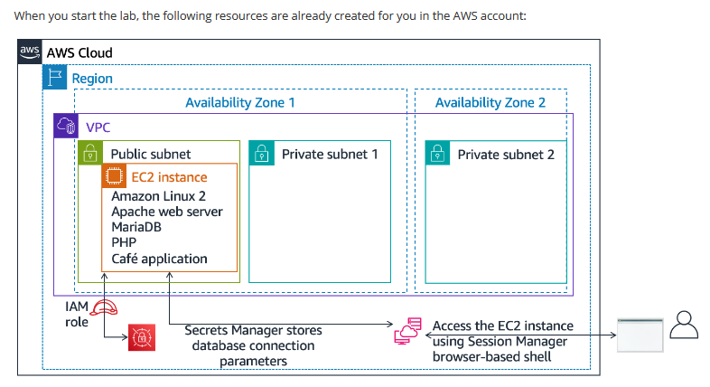
*Reference: starting architecture from the AWS Academy lab.*

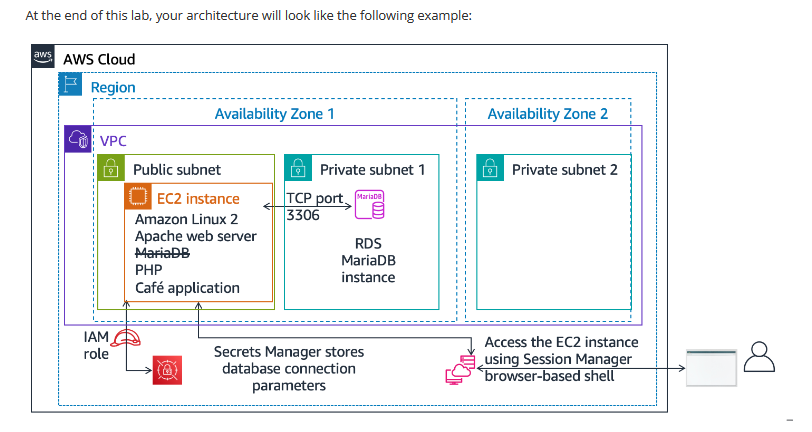
*Reference: target architecture from the AWS Academy lab.*

## AWS Services Used

| Service | Role in this stage |
|---|---|
| Amazon RDS (MariaDB) | Managed database replacing the local MariaDB on EC2 |
| Amazon EC2 | Hosts the café web application (database removed from it) |
| AWS Secrets Manager | Holds the DB connection parameters the PHP code reads |
| AWS Systems Manager (Session Manager) | Browser-based shell into the EC2 instance |
| VPC security groups | Control which source can reach the database on port 3306 |

## Implementation Highlights

- **Reviewed what existed.** I tested the running café site (placed an order, checked Order History) and opened a Session Manager shell on the EC2 instance. The local MariaDB 10.2.38 held `cafe_db` with four tables (`order`, `order_item`, `product`, `product_group`) and 25 orders at that point.
- **Created the RDS instance.** `CafeDatabase`: MariaDB 10.6.25, `db.t3.micro`, placed in the Lab VPC using `lab-db-subnet-group`, not publicly accessible, attached to the `dbSG` security group.
- **Exported and imported the data.** I dumped `cafe_db` with `mysqldump` into `CafeDbDump.sql` and loaded it into RDS with the `mysql` client, then queried RDS to confirm the same 25 orders were there.
- **Switched the application by configuration only.** No PHP changes: I updated the `dbUrl`, `dbUser` and `dbPassword` secrets in Secrets Manager to point at RDS, stopped the local MariaDB service, and confirmed the site still worked.

## Challenges & Decisions

- **Decision — database access limited by security group.** My first connection from the EC2 instance to RDS failed with `ERROR 2002` (E12). I added an inbound rule on `dbSG` for MySQL/Aurora TCP 3306 with a **security group as the source** rather than an open IP range (E13), then confirmed with `nmap` that port 3306 was open before logging in (E14).
- **Observation — Order History while the local database was stopped.** One screenshot shows "Connection failed: Connection refused" on the Order History page (E17), and the terminal shows `mariadb` being stopped and started (E19). <!-- TODO (optional): confirm the sequence and what I changed, if I remember --> <!-- TODO (optional): any other V3 problems -->

## Validation & Evidence

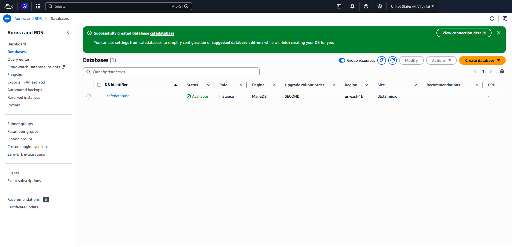
*RDS instance `CafeDatabase` available.*
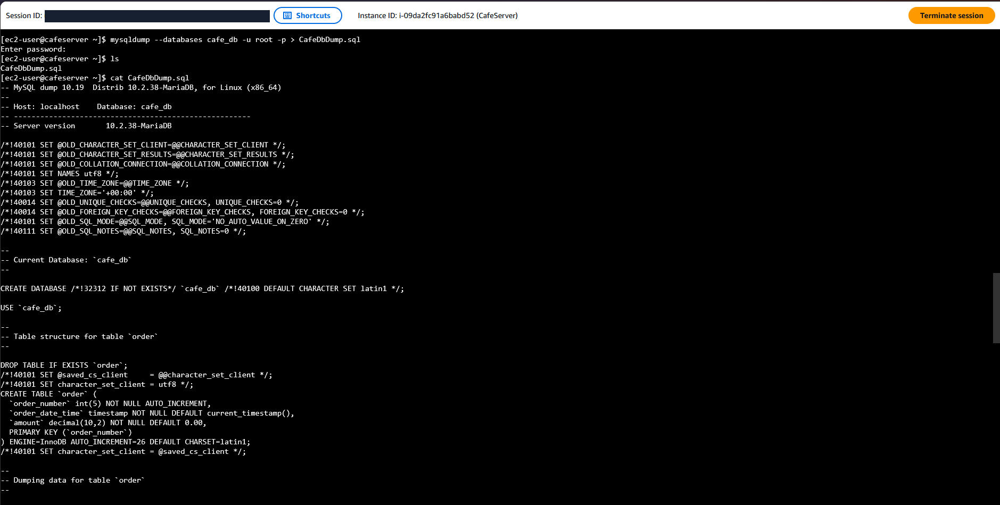
*Exporting the café database with `mysqldump`.*
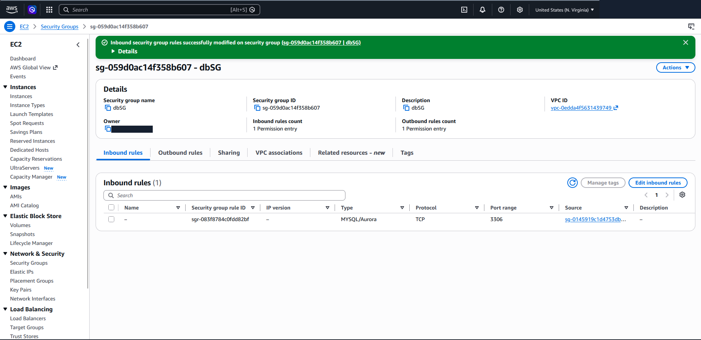
*`dbSG` allows MySQL (3306) only from a security group.*
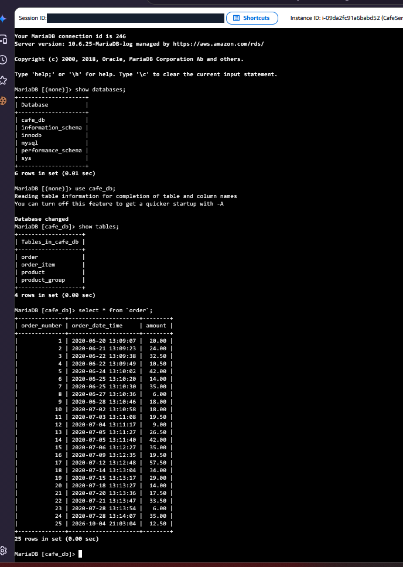
*All 25 orders present on RDS after the import.*
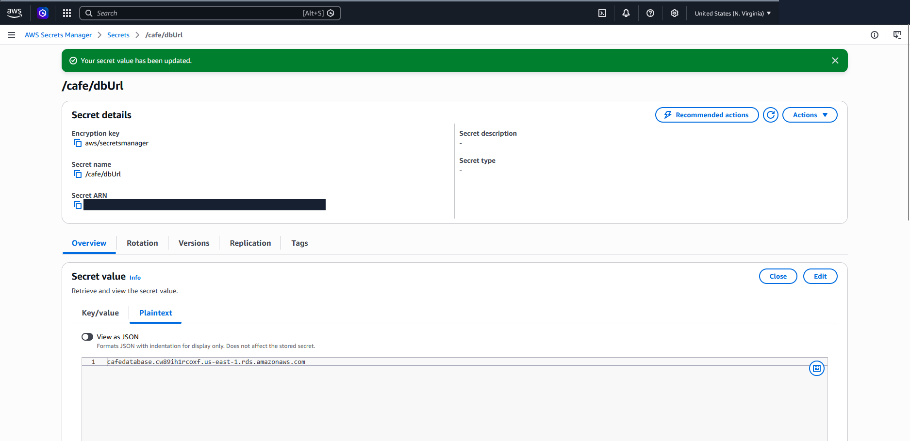
*`dbUrl` secret now points to the RDS endpoint.*
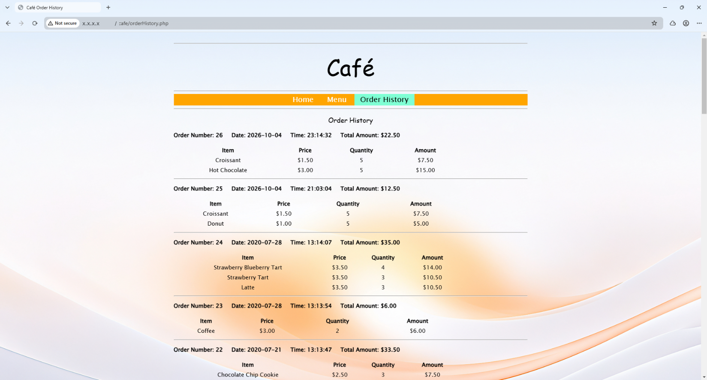
*Order #26 (new) plus the migrated history, served from RDS.*

### Evidence index (all screenshots)

| ID | What it shows | File |
|---|---|---|
| V3-E01 | RDS console: `CafeDatabase` created and showing Available (MariaDB, db.t3.micro, us-east-1) | `V3-E01-rds-instance-available.png` |
| V3-E02 | Café website home page running on the EC2 instance (public IP masked) | `V3-E02-cafe-website-live-on-ec2.png` |
| V3-E03 | Order Confirmation page after placing a test order (order #25) | `V3-E03-order-confirmation.png` |
| V3-E04 | Order History before migration: original orders plus my test order, all served from the local database | `V3-E04-order-history-before-migration.png` |
| V3-E05 | Connect to instance dialog with Session Manager selected (browser-based shell, no SSH keys) | `V3-E05-connect-via-session-manager.png` |
| V3-E06 | Secrets Manager `/cafe/dbPassword` secret (ARN and value masked) | `V3-E06-secrets-manager-dbpassword.png` |
| V3-E07 | Terminal: local MariaDB 10.2.38 running on the EC2 instance and root login to the SQL client | `V3-E07-mariadb-status-and-login.png` |
| V3-E08 | Source database: `cafe_db` with its four tables and 25 rows in `order` | `V3-E08-source-db-orders-table.png` |
| V3-E09 | Source database: rows in `order_item` (items, quantities, prices per order) | `V3-E09-source-db-order-items.png` |
| V3-E10 | `mysqldump` creating `CafeDbDump.sql` and a `cat` of the start of the dump file | `V3-E10-mysqldump-cafedbdump.png` |
| V3-E11 | RDS connectivity details: endpoint, port 3306, Lab VPC, `lab-db-subnet-group`, `dbSG`, Publicly accessible = No | `V3-E11-rds-connectivity-details.png` |
| V3-E12 | First connection attempt from EC2 to RDS fails with ERROR 2002 (can't connect) | `V3-E12-rds-connection-error-2002.png` |
| V3-E13 | `dbSG` inbound rule: MySQL/Aurora, TCP 3306, source = a security group | `V3-E13-dbsg-inbound-rule-3306.png` |
| V3-E14 | `nmap` shows 3306/tcp open on the RDS endpoint, then a successful login (server 10.6.25-MariaDB) | `V3-E14-nmap-port-open-and-rds-login.png` |
| V3-E15 | RDS after the import: `cafe_db` present, four tables, 25 orders | `V3-E15-rds-data-verified-25-orders.png` |
| V3-E16 | Café menu page (`menu.php`) used to test the application | `V3-E16-cafe-menu-page.png` |
| V3-E17 | Order History page showing "Connection failed: Connection refused" | `V3-E17-order-history-connection-refused.png` |
| V3-E18 | Secrets Manager `/cafe/dbUrl` updated with the RDS endpoint | `V3-E18-secret-dburl-updated.png` |
| V3-E19 | Terminal: end of the RDS verification output (25 rows), then `sudo service mariadb stop` on the EC2 instance | `V3-E19-stop-local-mariadb.png` |
| V3-E20 | Secrets Manager `/cafe/dbUser` updated (`admin`) | `V3-E20-secret-dbuser-updated.png` |
| V3-E21 | Secrets Manager `/cafe/dbPassword` updated (value masked) | `V3-E21-secret-dbpassword-updated.png` |
| V3-E22 | Final Order History: new order #26 placed after the switch, with all migrated orders still present | `V3-E22-order-history-after-migration.png` |

<b>More evidence (all screenshots, in lab order)</b>

#### Task 1–2 — Existing application and RDS instance

*RDS console: `CafeDatabase` created and showing Available (MariaDB, db.t3.micro, us-east-1)*

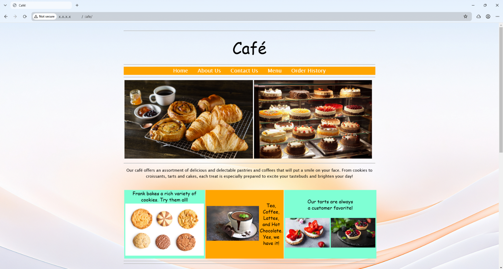
*Café website home page running on the EC2 instance (public IP masked)*

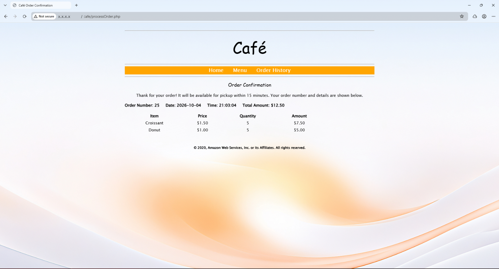
*Order Confirmation page after placing a test order (order #25)*

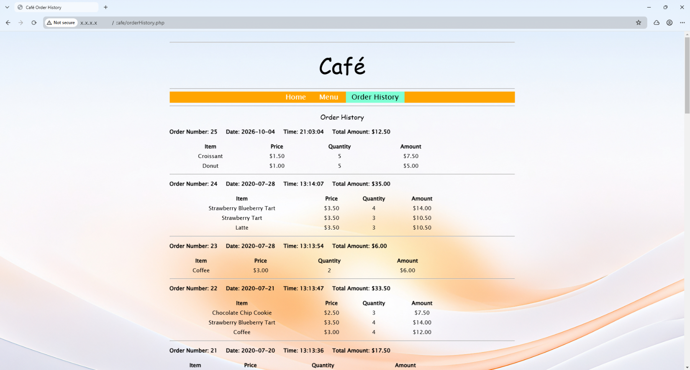
*Order History before migration: original orders plus my test order, all served from the local database*

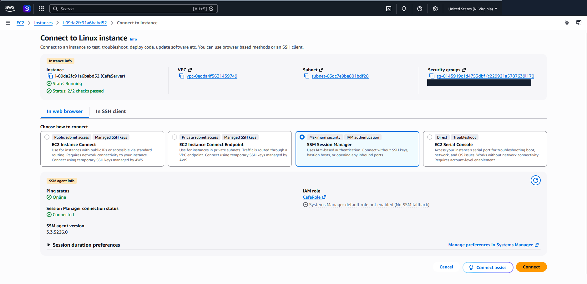
*Connect to instance dialog with Session Manager selected (browser-based shell, no SSH keys)*

#### Task 3 — Source database and export

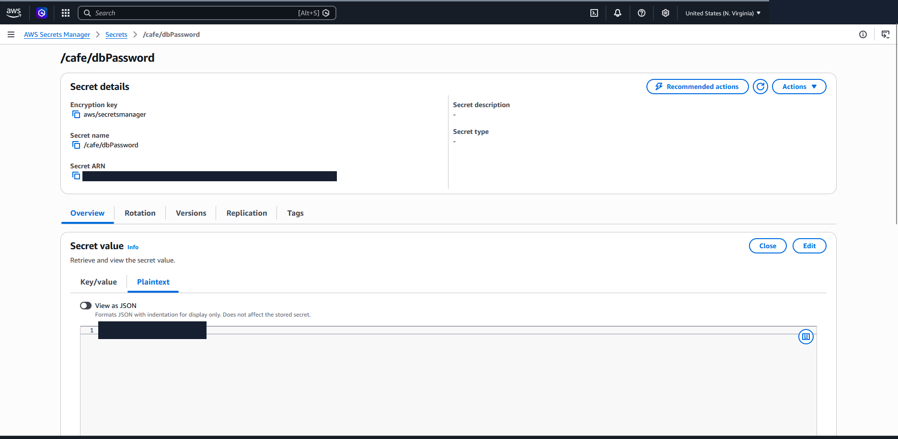
*Secrets Manager `/cafe/dbPassword` secret (ARN and value masked)*

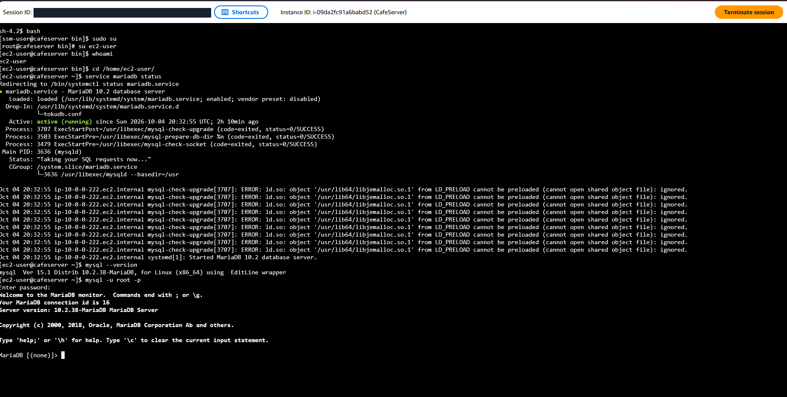
*Terminal: local MariaDB 10.2.38 running on the EC2 instance and root login to the SQL client*

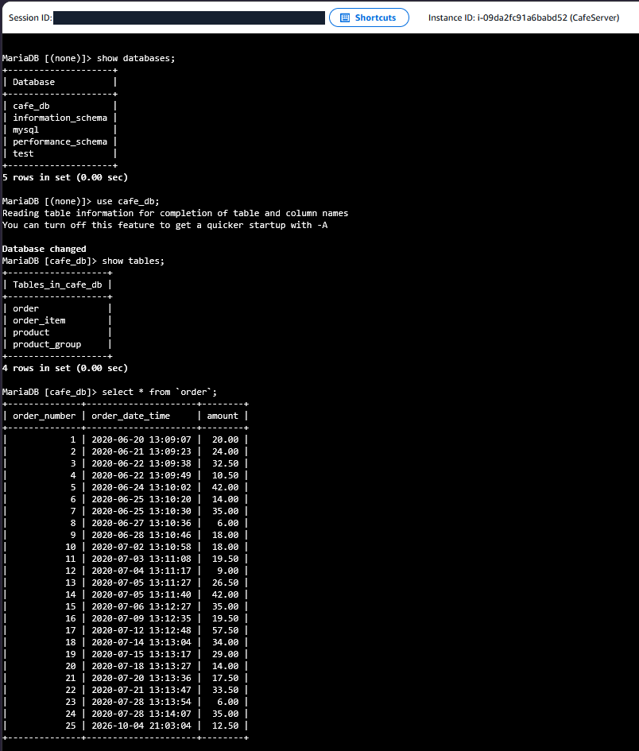
*Source database: `cafe_db` with its four tables and 25 rows in `order`*

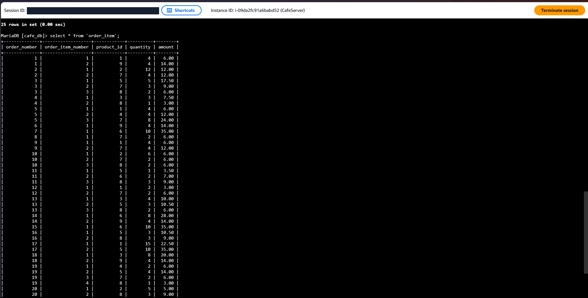
*Source database: rows in `order_item` (items, quantities, prices per order)*

*`mysqldump` creating `CafeDbDump.sql` and a `cat` of the start of the dump file*

#### Task 4 — Connecting EC2 to RDS

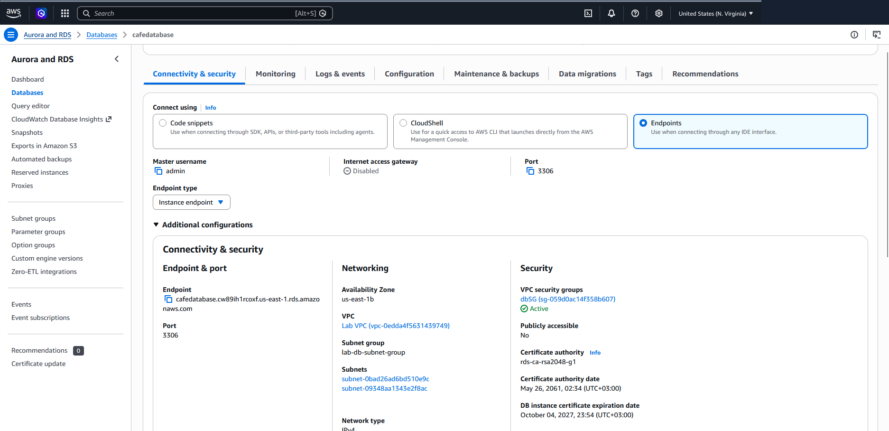
*RDS connectivity details: endpoint, port 3306, Lab VPC, `lab-db-subnet-group`, `dbSG`, Publicly accessible = No*

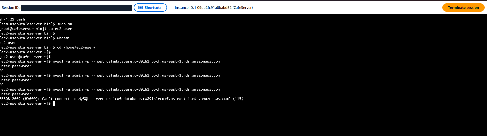
*First connection attempt from EC2 to RDS fails with ERROR 2002 (can't connect)*

*`dbSG` inbound rule: MySQL/Aurora, TCP 3306, source = a security group*

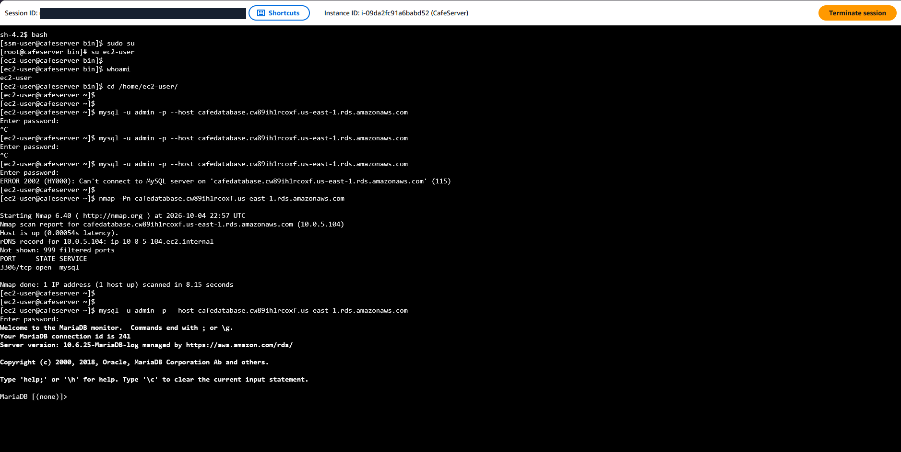
*`nmap` shows 3306/tcp open on the RDS endpoint, then a successful login (server 10.6.25-MariaDB)*

#### Task 5 — Import and verification

*RDS after the import: `cafe_db` present, four tables, 25 orders*

#### Task 6 — Switching the application to RDS (in the order they appear in my screenshot file)

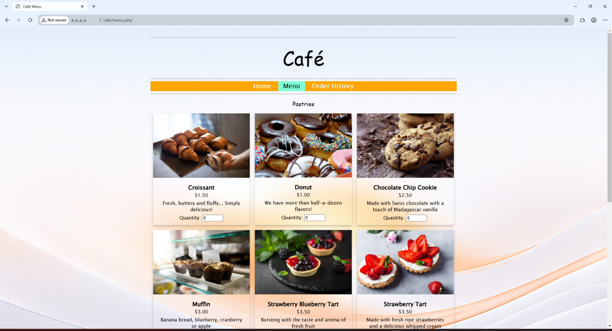
*Café menu page (`menu.php`) used to test the application*

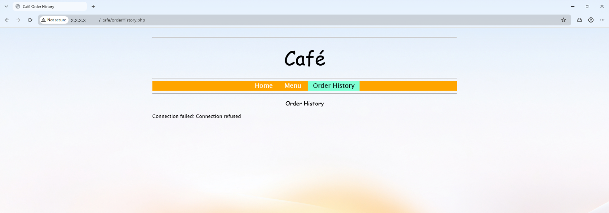
*Order History page showing "Connection failed: Connection refused"*

*Secrets Manager `/cafe/dbUrl` updated with the RDS endpoint*

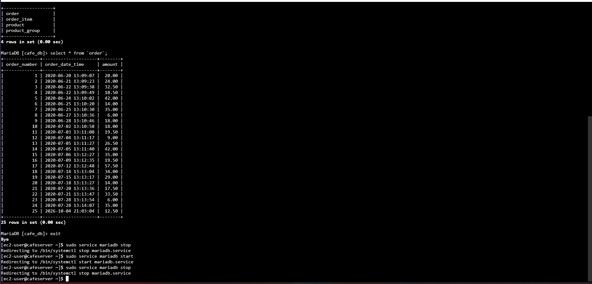
*Terminal: end of the RDS verification output (25 rows), then `sudo service mariadb stop` on the EC2 instance*

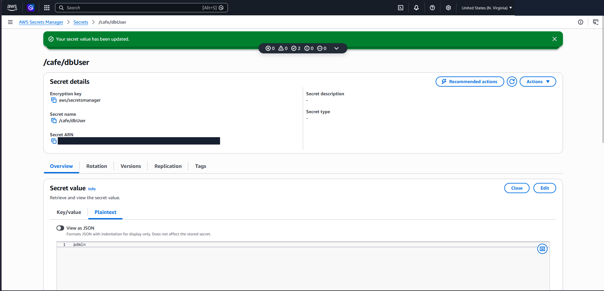
*Secrets Manager `/cafe/dbUser` updated (`admin`)*

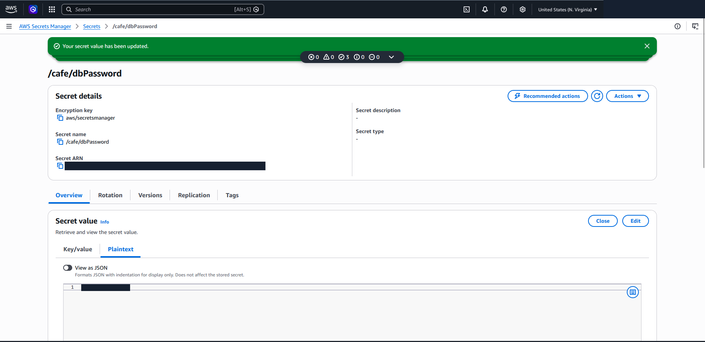
*Secrets Manager `/cafe/dbPassword` updated (value masked)*

*Final Order History: new order #26 placed after the switch, with all migrated orders still present*

## Outcome

The café's order data now lives in a managed Amazon RDS MariaDB instance in the private database subnets, reachable only from the application's security group. The application kept all 25 existing orders and accepted new ones (order #26) after the switch, with no code changes.

---
Previous: [V2 — Dynamic Website](v2-dynamic-website.md) · Next: [V4 — Secure VPC](v4-secure-vpc.md)
