# V4 — Secure VPC Networking

> Completed as part of an **AWS Academy Challenge Lab** (training environment).
> Part of the [AWS Café — Cloud Architecture Journey](../README.md): V1 → V7.

---

## Business Requirement

After moving the database to a private subnet (V3), the café team wanted to improve the security of the application layer as well. Their AWS advisor recommended running the application server in a private subnet that is not reachable from the internet, and giving administrators access only through a **bastion host** (jump box). The private server still has to download patches, so it needs outbound internet access without being exposed to inbound connections.

The team also wanted a **non-production VPC** where they could build and test this design, plus an extra security layer around the private subnet using a **custom network ACL**.

**Lab objectives**

- Create a VPC environment that allows secure connections to private resources
- Let private resources reach the internet without being publicly reachable
- Add security layers (NAT gateway, security groups, network ACL) around the private resources

---

## Before → After

| | Before | After |
|---|---|---|
| Network | A VPC with no usable subnets | Public subnet `10.0.0.0/24` and private subnet `10.0.1.0/24` in the Lab VPC (`10.0.0.0/16`) |
| Internet access (public) | None | Internet gateway attached; public route `0.0.0.0/0 → IGW` |
| Admin access | – | SSH only through a bastion host in the public subnet |
| Private resources | – | Private instance with no public IP, SSH allowed only from the bastion's security group |
| Outbound access from private subnet | – | NAT gateway in the public subnet; private route `0.0.0.0/0 → NAT` |
| Extra layer | – | Custom network ACL tested by blocking ICMP between instances |

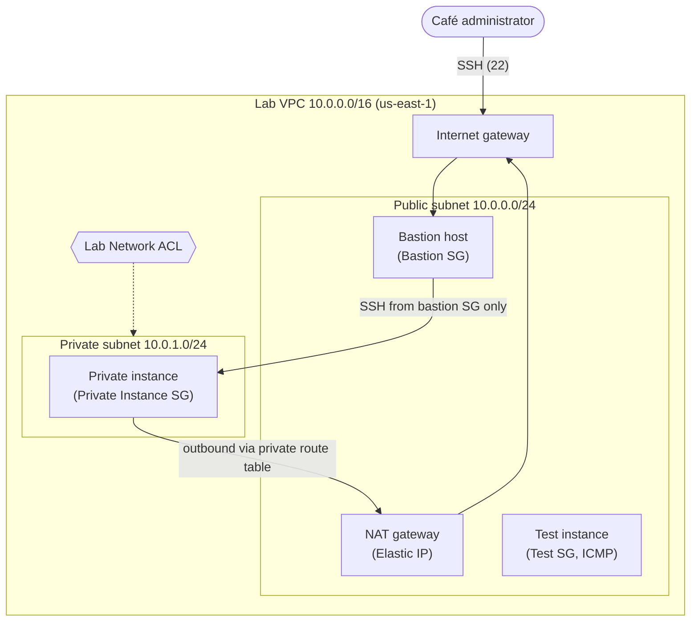

### Reference architecture (from the AWS Academy lab)

These two diagrams come from the lab material and show the target design that I built. They are included for reference; the diagram above reflects what I actually deployed.

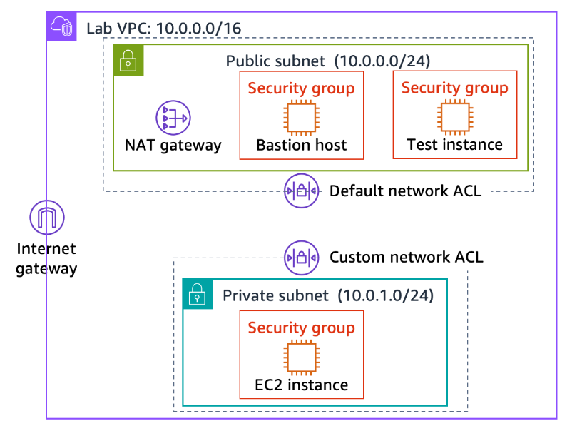
*Reference: target architecture from the AWS Academy lab.*

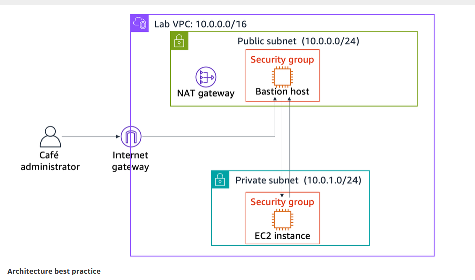
*Reference: administrator reaching the private subnet through the bastion host (AWS Academy lab).*

---

## AWS Services Used

| Service / feature | Role in V4 |
|---|---|
| Amazon VPC | The isolated network (`10.0.0.0/16`) holding all resources |
| Subnets (public + private) | Separate internet-facing and internal resources |
| Internet gateway | Connects the public subnet to the internet |
| Route tables | Public route to the IGW; separate private route table pointing to the NAT gateway |
| NAT gateway + Elastic IP | Lets private instances start outbound connections (patches, updates) without inbound exposure |
| Amazon EC2 | Bastion host, private instance and test instance (Amazon Linux 2023, `t2.micro`) |
| Security groups | Instance-level firewall (SSH from my IP to bastion; SSH from bastion SG to private instance; ICMP for the test instance) |
| Network ACL | Subnet-level, stateless firewall layer with explicit allow/deny rules |
| Key pairs / SSH (PuTTY) | Key-based SSH access to the bastion and, through it, to the private instance |

---

## Implementation Highlights

1. **Public subnet and internet access.** Created a public subnet (`10.0.0.0/24`) in the Lab VPC, created a new internet gateway (`igw-new`) and attached it to the VPC, then added a route `0.0.0.0/0 → internet gateway` to the route table that serves the public subnet. *(E01, E02, E03)*
2. **Bastion host.** Launched an EC2 instance (Amazon Linux 2023, `t2.micro`) in the public subnet and connected to it over SSH (port 22) from my machine using PuTTY and a `.ppk` key. *(E04)*
3. **Private subnet.** Created a second subnet (`10.0.1.0/24`) for private resources. *(E05)*
4. **NAT gateway.** Created `Lab NAT Gateway` in the public subnet with an Elastic IP, so that instances in the private subnet can reach the internet. *(E06)*
5. **Separate route table for the private subnet.** Created `Private Route Table` in the Lab VPC, added `0.0.0.0/0 → NAT gateway`, and associated it explicitly with the private subnet. The public subnet keeps using the VPC's main route table (which has the internet gateway route). *(E07, E08, E09)*
6. **Private instance.** Launched an EC2 instance in the private subnet with a new key pair (`vockey2`) and a security group (`Private Instance SG`) that allows SSH (22) **only from the bastion host's security group**. It has no public IP. *(E09)*
7. **SSH pass-through.** Configured the PuTTY session so I could SSH into the bastion and from there into the private instance, without copying the private key onto the bastion. *(E10)*
8. **Connectivity test.** From the private instance, `ping 8.8.8.8` succeeded, which confirms outbound internet access through the NAT gateway. *(E10)*
9. **Network ACL.** Created `Lab Network ACL` for the Lab VPC. A custom ACL starts by denying everything, so I added allow-all rules (rule 100) in both directions, plus a lower-numbered **deny ICMP** rule (rule 99) for the private instance's address (`10.0.1.142/32`). *(E12, E13)*
10. **ACL test.** Launched a `Test Instance` in the public subnet (security group allowing ICMP), confirmed that the private instance could ping it, then added the deny rule and confirmed the ping stopped working (12 packets sent, 0 received). *(E11, E14)*

---

## Challenges & Decisions

**1. I lost SSH access to the bastion host after my home IP changed.**
I had limited the bastion's SSH rule to **My IP** (the right security choice). After my home router restarted, my public IP changed and SSH stopped working. I updated the access by adding a new inbound rule for the new IP, because editing the existing one did not work for me in the console. *(No screenshot.)*
**What I learned:** restricting SSH to a single IP is good practice, but with a dynamic home IP it breaks easily. Things I would do next time: remove the old rule once the new one works (so stale IPs don't stay allowed), and in a real environment use AWS Systems Manager Session Manager or a VPN instead of opening port 22 at all.

**2. Why a bastion host and not a public IP on the private server.**
The application server should be reachable only by admins. The private instance has no public IP, and its security group accepts SSH only from the bastion's security group (a reference to the group, not an IP range). So there is exactly one way in, and that door is a single hardened host.

**3. The NAT gateway needs both a public subnet and a private route.**
Creating the NAT gateway alone did not give the private instance internet access. Two more pieces were needed: the NAT gateway must sit in the **public** subnet (so it can use the internet gateway), and the **private subnet's route table** must send `0.0.0.0/0` to the NAT gateway. That is why I created a separate `Private Route Table` instead of reusing the main one. After that, `ping 8.8.8.8` worked from the private instance. *(E07, E08, E10)*

**4. Security groups vs. network ACLs.**
Security groups are stateful and instance-level; network ACLs are stateless and subnet-level. A custom ACL starts by denying all traffic, and rules are evaluated in number order, so the deny rule must have a **lower number (99) than the allow-all rule (100)** to take effect. Because ACLs are stateless, I also needed a matching rule in the outbound direction, not only inbound. *(E12, E13)*

**5. Things I noticed while documenting this lab (for honesty and next time):**
- **The deny rule uses the private instance's address (`10.0.1.142/32`).** The lab's wording asks for a rule that denies ICMP to the *Test Instance's* `/32` address. My rules reference the *private instance's* address instead, in both directions. The test result is the same (ping to the Test Instance stops), but the rule matches the opposite end of the conversation. *(E12, E13)*
- **The custom ACL ended up associated with both subnets.** The lab expects the custom ACL to protect the private subnet only, while the public subnet stays on the default ACL. In my account the Lab Network ACL shows two associated subnets (public and private). That is likely why the ping was blocked at both ends. In a real design I would associate it only with the private subnet. *(E15)*
- **The internet route for the public subnet lives in the VPC's main route table.** This works, but a safer pattern is to keep the main route table private and create an explicit public route table, so a new subnet is never public by accident.

---

## Validation & Evidence

### Whole network at a glance (E09)

The VPC resource map shows the Lab VPC with its two subnets, the two route tables, the internet gateway and the NAT gateway.

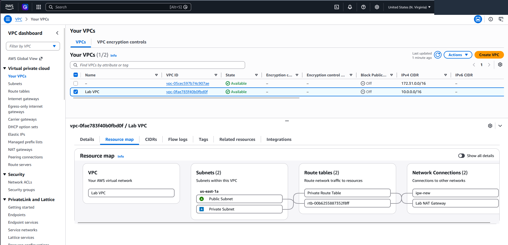

### Access through the bastion host (E04)

SSH session to the bastion host (public subnet), running on the Lab VPC.

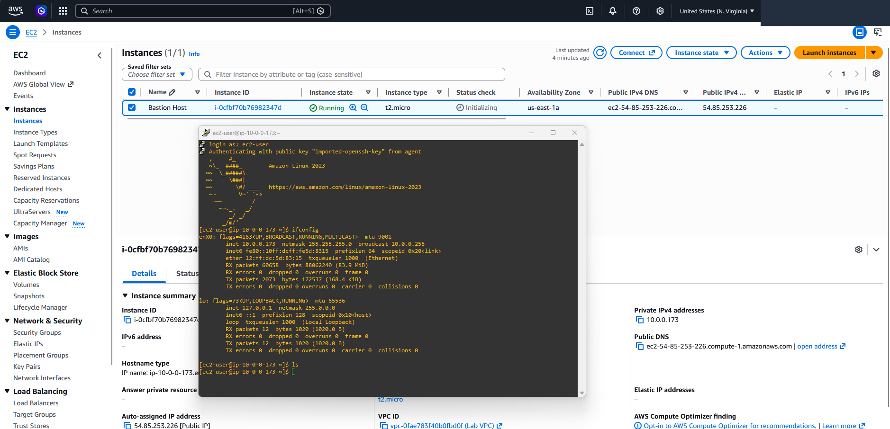

### Private route table sends internet traffic to the NAT gateway (E07)

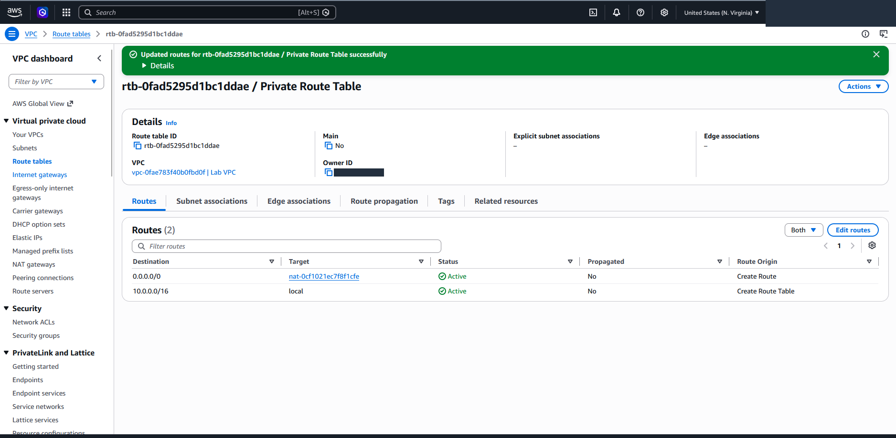

### Private instance reaches the internet through the NAT gateway (E10)

SSH hop from the bastion to the private instance, then a successful `ping 8.8.8.8` (0% packet loss).

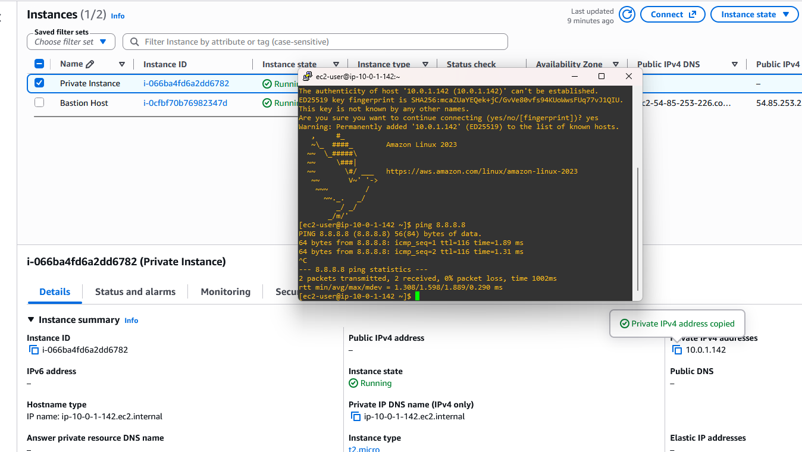

### Network ACL rules (E12)

Rule 99 denies ICMP for the specified address; rule 100 allows everything else; the default `*` rule denies.

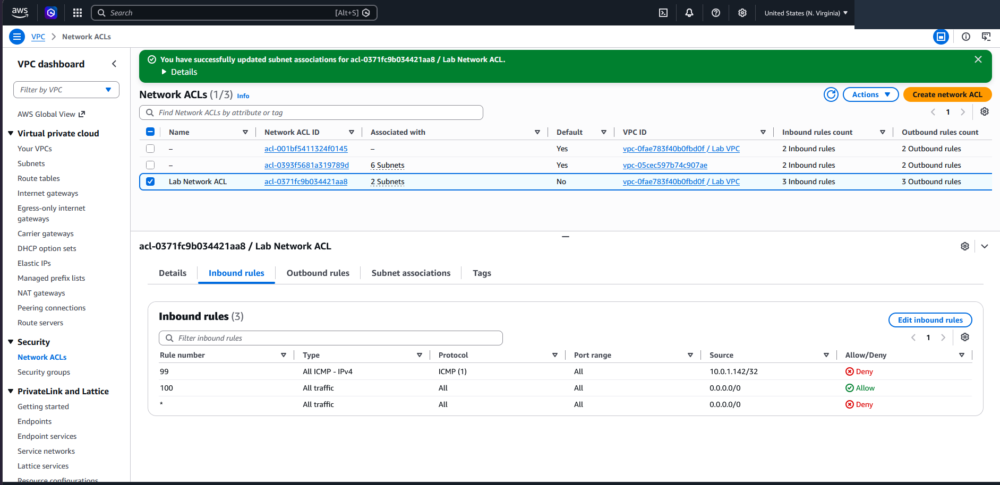

### Ping blocked by the ACL (E14)

After adding the deny rule, the ping to the Test Instance no longer gets replies.

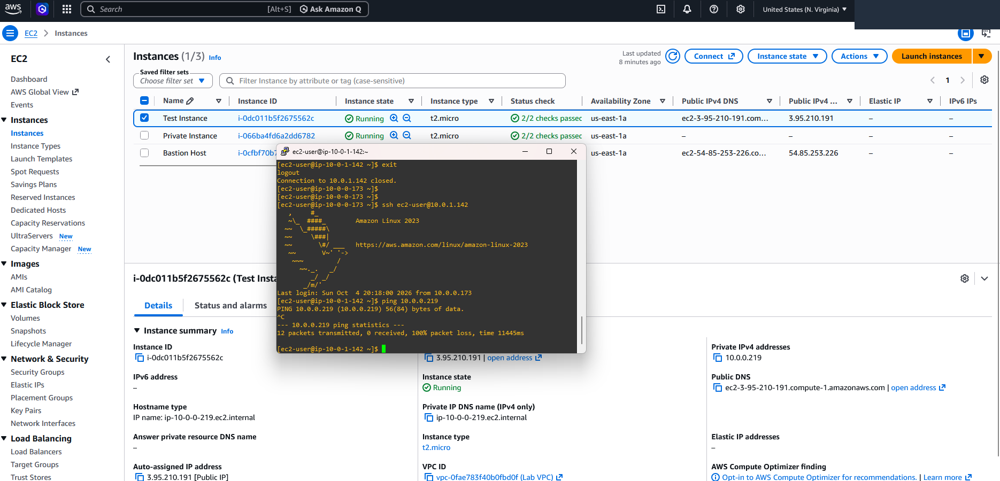

### Evidence index

| ID | What it shows | File |
|---|---|---|
| V4-E01 | Public subnet `10.0.0.0/24` created | `V4-E01-public-subnet-created.png` |
| V4-E02 | Internet gateway attached to the Lab VPC | `V4-E02-internet-gateway-attached.png` |
| V4-E03 | Route `0.0.0.0/0 → internet gateway` | `V4-E03-public-route-to-igw.png` |
| V4-E04 | Bastion host running, SSH session open | `V4-E04-bastion-host-ssh-session.png` |
| V4-E05 | Private subnet `10.0.1.0/24` created | `V4-E05-private-subnet-created.png` |
| V4-E06 | NAT gateway created in the public subnet | `V4-E06-nat-gateway-created.png` |
| V4-E07 | Private route table: `0.0.0.0/0 → NAT gateway` | `V4-E07-private-route-to-nat.png` |
| V4-E08 | Private route table associated with the private subnet | `V4-E08-private-route-table-association.png` |
| V4-E09 | VPC resource map | `V4-E09-vpc-resource-map.png` |
| V4-E10 | Private instance reaches internet via NAT | `V4-E10-private-instance-internet-via-nat.png` |
| V4-E11 | Ping to Test Instance works before the deny rule | `V4-E11-ping-test-instance-before-acl.png` |
| V4-E12 | Network ACL inbound rules | `V4-E12-network-acl-inbound-rules.png` |
| V4-E13 | Network ACL outbound rules | `V4-E13-network-acl-outbound-rules.png` |
| V4-E14 | Ping blocked by the ACL | `V4-E14-ping-blocked-by-acl.png` |
| V4-E15 | Subnets associated with the Lab Network ACL | `V4-E15-network-acl-subnet-associations.png` |
| V4-E16 | Internet gateway created | `V4-E16-internet-gateway-created.png` |
| V4-E17 | Attaching the internet gateway to the Lab VPC | `V4-E17-attach-igw-to-vpc.png` |
| V4-E18 | Main route table before adding the internet route | `V4-E18-main-route-table-before.png` |
| V4-E19 | Launching the bastion host (Amazon Linux 2023) | `V4-E19-launch-bastion-host.png` |
| V4-E20 | Creating the NAT gateway (public subnet, Elastic IP) | `V4-E20-create-nat-gateway.png` |
| V4-E21 | Creating the Private Route Table | `V4-E21-create-private-route-table.png` |
| V4-E22 | Editing the private route to point to the NAT gateway | `V4-E22-private-route-edit-nat.png` |
| V4-E23 | PuTTY session to the bastion host (port 22) | `V4-E23-putty-session-bastion.png` |
| V4-E24 | PuTTY: authentication options, agent forwarding enabled | `V4-E24-putty-agent-forwarding.png` |
| V4-E25 | PuTTY: private key for authentication (path redacted) | `V4-E25-putty-private-key-auth.png` |
| V4-E26 | Logged in to the bastion host | `V4-E26-bastion-login.png` |
| V4-E27 | SSH hop from the bastion to the private instance | `V4-E27-ssh-hop-to-private-instance.png` |

<b>More evidence (all screenshots, in lab order)</b>

 

**Task 1 — Public subnet and internet gateway**

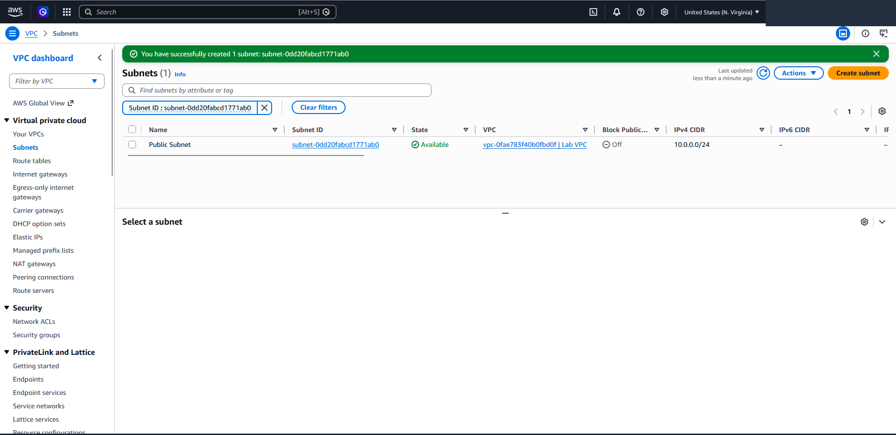
*E01 — Public subnet created.*

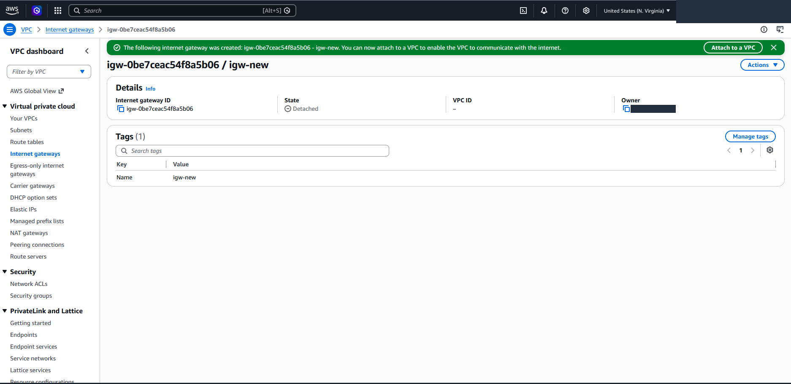
*E16 — Internet gateway created.*

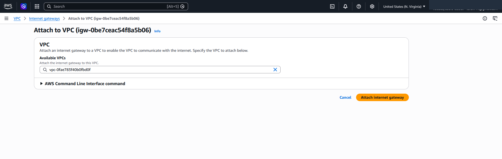
*E17 — Attaching the internet gateway to the Lab VPC.*

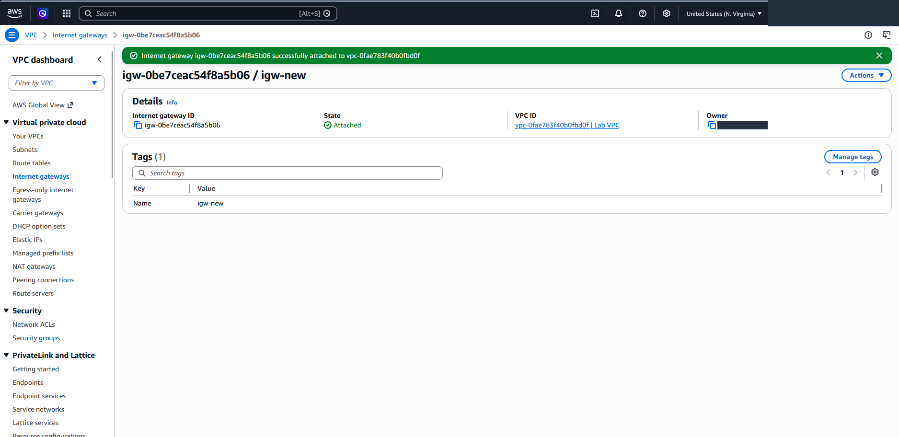
*E02 — Internet gateway attached.*

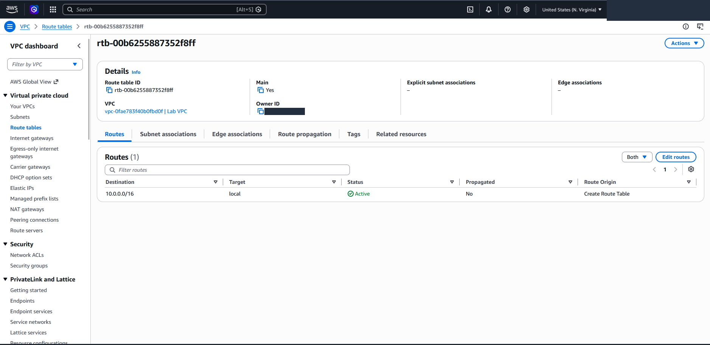
*E18 — Main route table before adding the internet route.*

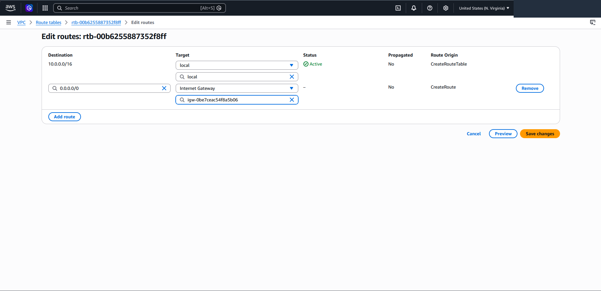
*E03 — Route `0.0.0.0/0` to the internet gateway.*

**Tasks 2–3 — Bastion host**

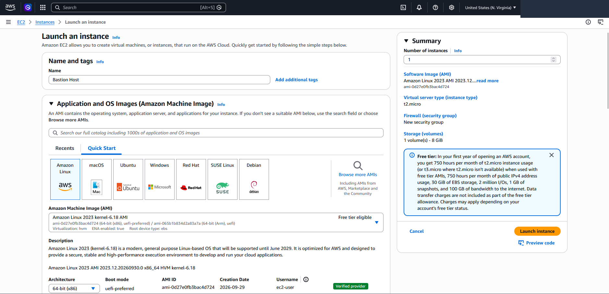
*E19 — Launching the bastion host.*

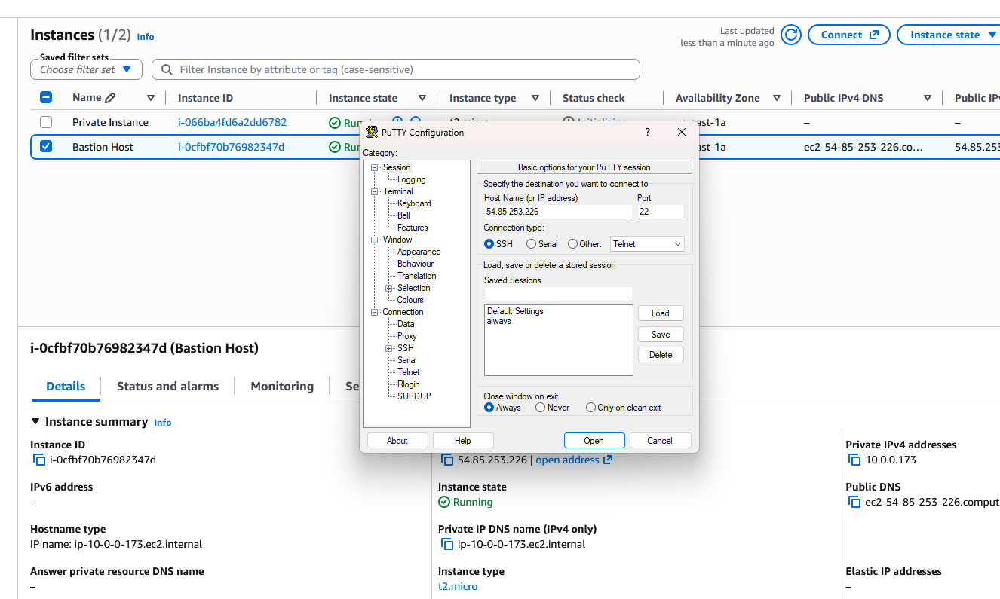
*E23 — PuTTY session to the bastion host.*

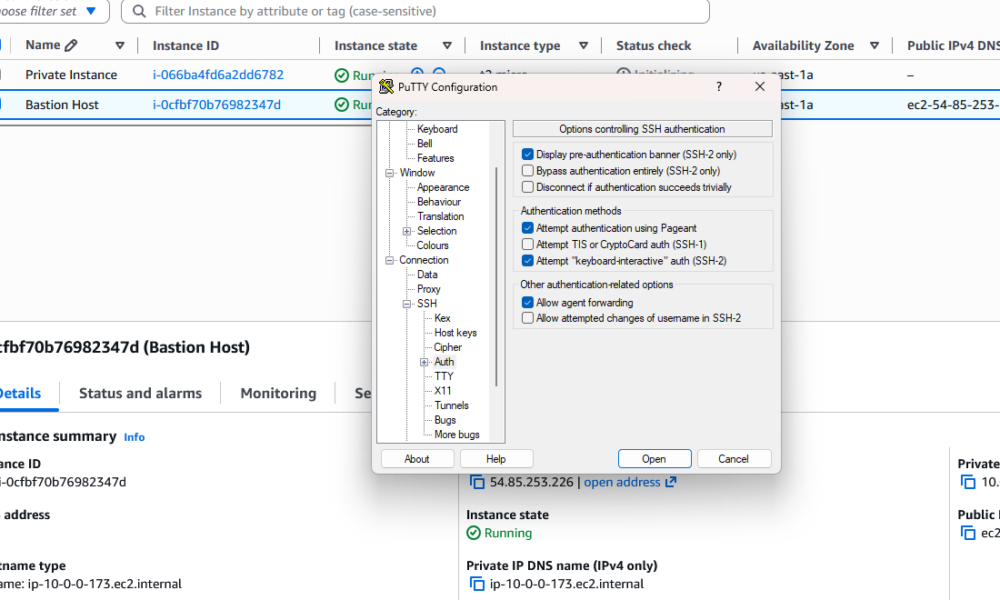
*E24 — PuTTY authentication options (agent forwarding).*

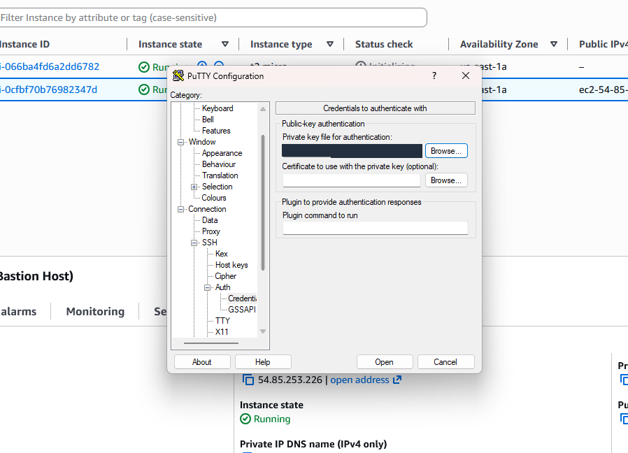
*E25 — PuTTY private key setting (file path redacted).*

*E04 — Bastion host running with an open SSH session.*

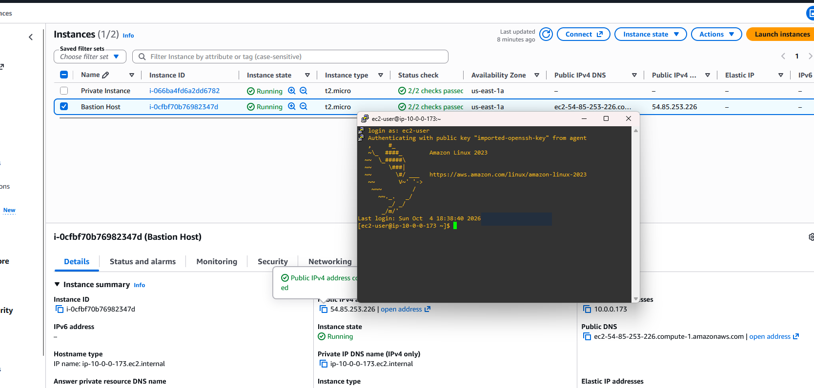
*E26 — Logged in to the bastion host.*

**Tasks 4–5 — Private subnet and NAT gateway**

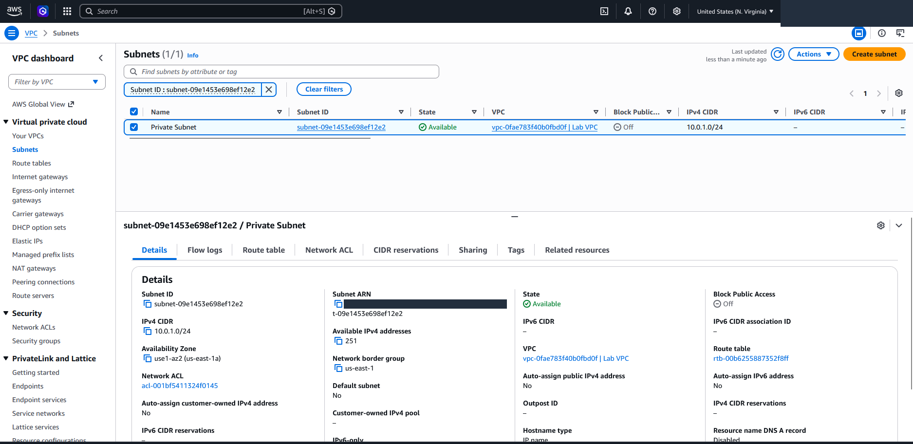
*E05 — Private subnet created.*

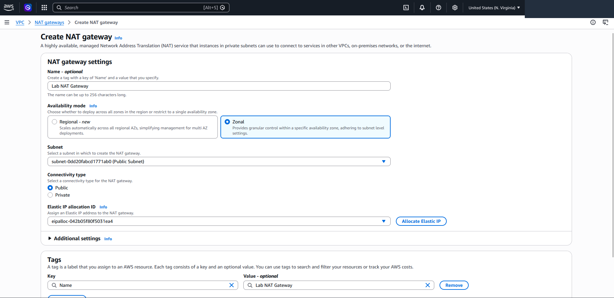
*E20 — Creating the NAT gateway.*

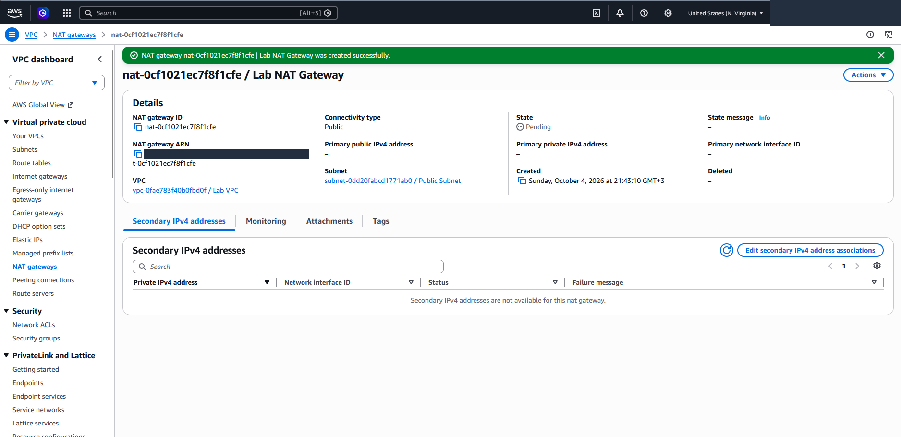
*E06 — NAT gateway created.*

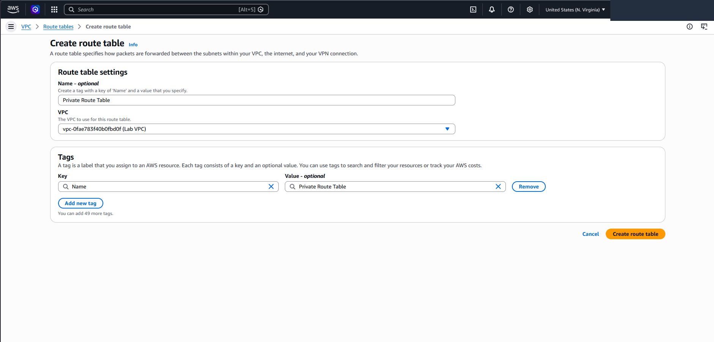
*E21 — Creating the Private Route Table.*

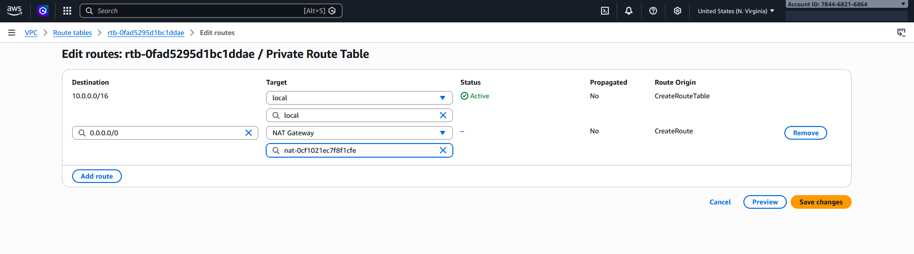
*E22 — Adding the route to the NAT gateway.*

*E07 — Private route table with the NAT route.*

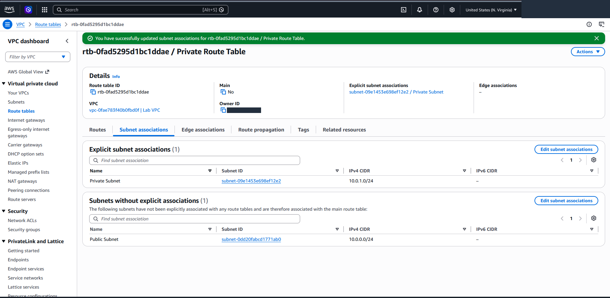
*E08 — Private route table associated with the private subnet.*

*E09 — VPC resource map.*

**Tasks 6–8 — Private instance and SSH pass-through**

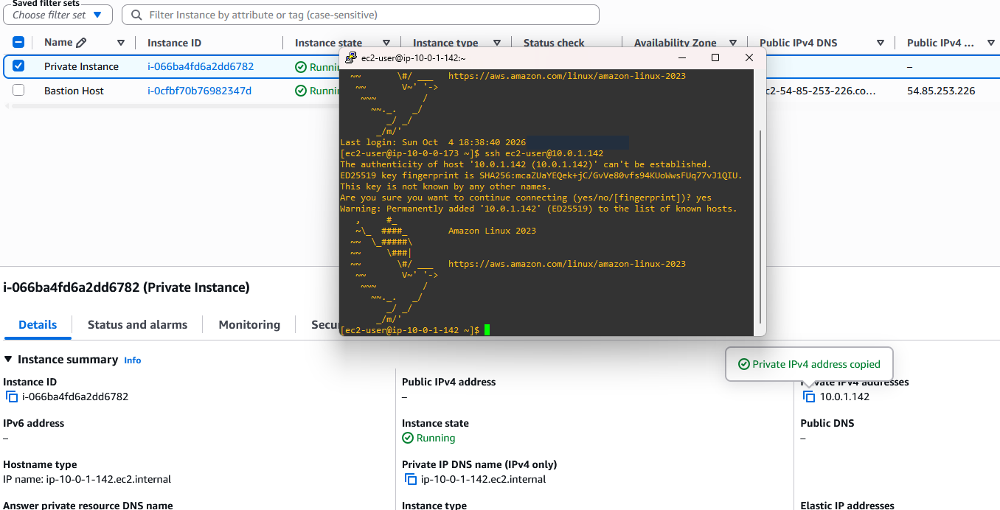
*E27 — SSH hop from the bastion host to the private instance.*

*E10 — Private instance reaches the internet through the NAT gateway.*

**Tasks 9–10 — Network ACL**

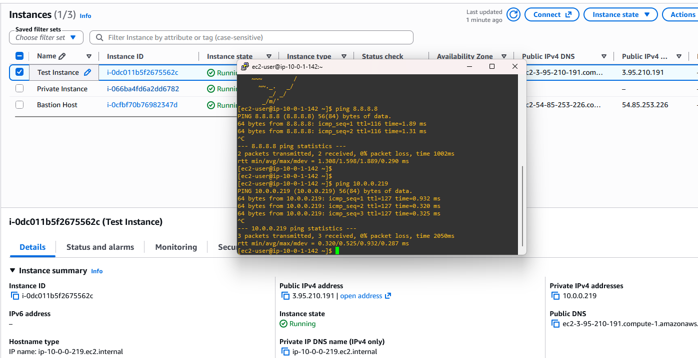
*E11 — Ping to the Test Instance works before the deny rule.*

*E12 — Network ACL inbound rules.*

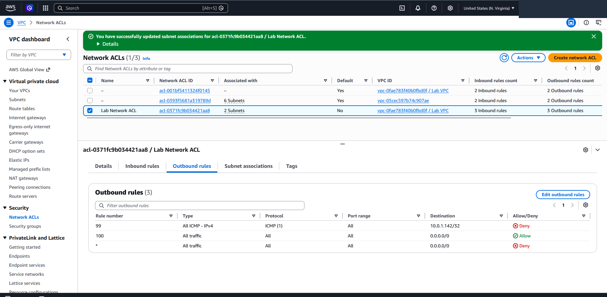
*E13 — Network ACL outbound rules.*

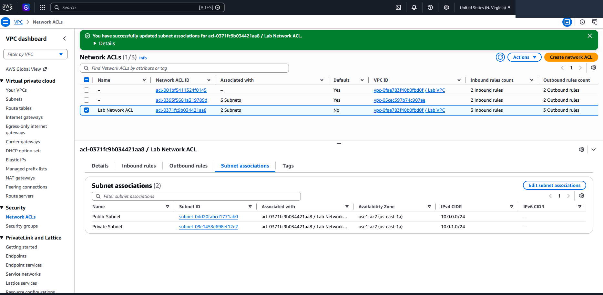
*E15 — Subnets associated with the Lab Network ACL.*

*E14 — Ping blocked by the network ACL.*

> **Note on evidence.** Account IDs, user details, ARNs, personal file paths and my own public IP address were redacted from all screenshots. The public IPs visible in some images belong to temporary lab instances that no longer exist.

---

## Outcome

The café now has a VPC with a public tier (bastion host, NAT gateway) and a private tier (private instance). Private resources have no public IP, are reachable only through the bastion host, can still reach the internet for updates through the NAT gateway, and sit behind an additional network ACL layer that I tested by blocking and observing traffic.

**Limits of this version (and what the next versions address):** a single Availability Zone means one failure can take the whole site down, and a single instance cannot absorb a traffic spike. V5 addresses this with a load balancer, Auto Scaling and a second Availability Zone.

⬅️ Previous: [V3 — Database Migration to Amazon RDS](./v3-rds-migration.md)
➡️ Next: [V5 — Scalability & High Availability](./v5-scalability-ha.md)
