# V5 - Scalability & High Availability (ALB + Auto Scaling)

> Completed as part of AWS Academy Challenge Labs (training environment).

## Business Requirement

The café was about to be featured on a TV food show, which could bring a short spike of up to tens of thousands of visitors. A single web server in a single Availability Zone could not absorb that traffic, so the website had to stay responsive, scale up and down with demand, and survive the loss of one Availability Zone.

## Before → After

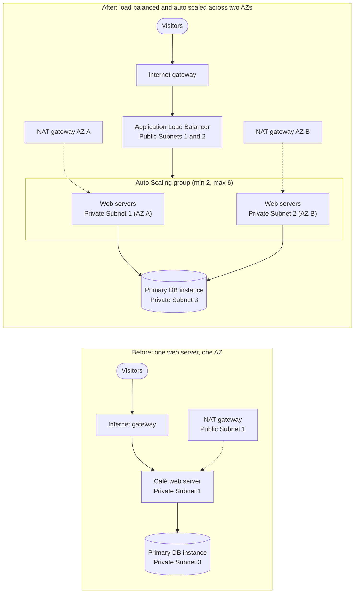

### Reference architecture

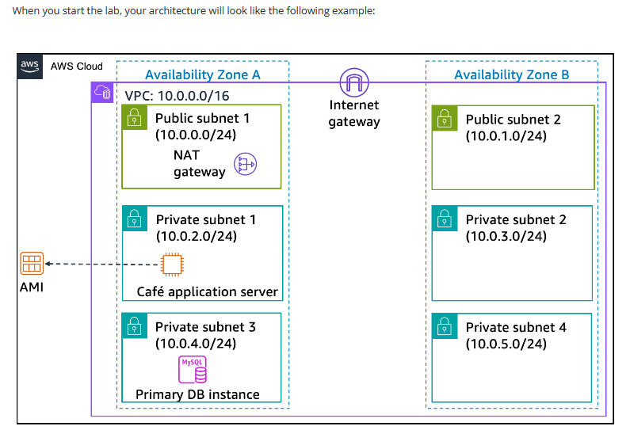
*Reference: starting architecture from the AWS Academy lab.*

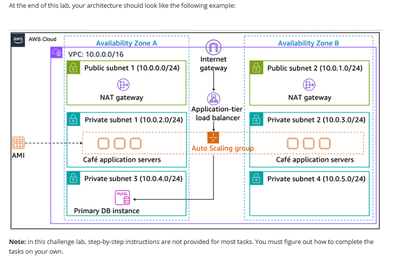
*Reference: target architecture from the AWS Academy lab.*

## AWS Services Used

| Service | Role in this stage |
|---|---|
| Amazon VPC (subnets, route tables, NAT gateway) | Second NAT gateway so private instances in the second AZ can reach the internet |
| Amazon EC2 (AMI, launch template) | Repeatable definition of the café web server (`CafeWebAppServer-temp`, t2.micro) |
| Amazon EC2 Auto Scaling | Keeps 2 to 6 web servers running across two AZs and scales on average CPU |
| Elastic Load Balancing (Application Load Balancer) | Public entry point that spreads HTTP requests across the private web servers |
| Amazon EC2 security groups | `CafeAPPELBallowHTTP` allows HTTP (port 80) from the internet to the load balancer |
| AWS Systems Manager Session Manager | Shell access to a web server to run the CPU stress test |

## Implementation Highlights

- **Network first.** The web servers sit in private subnets, so the second AZ needed its own NAT gateway before any instance could start there. I created a zonal NAT gateway (`natgw-az2`) in Public Subnet 2 and pointed the default route of Private Route Table 2 to it (E02, E04, E05).
- **One template for every server.** I built a launch template from the café AMI (`Cafe WebServer Image`) with a t2.micro instance type, so every instance the group starts is identical (E06-E09).
- **Auto Scaling group across two AZs.** The group uses Private Subnet 1 and Private Subnet 2 with desired 2, minimum 2 and maximum 6 instances, and scales on average CPU utilization (E10-E13).
- **Load balancer in the public subnets.** The Application Load Balancer `CafeAppELB` is internet-facing, sits in the two public subnets, and forwards HTTP:80 to the target group `CafeAPPELB-Targetgroup`. A dedicated security group opens port 80 to the internet. The Auto Scaling group was then attached to the target group so new instances register automatically (E14-E18).
- **Test under load.** I opened the site through the load balancer DNS name, then used Session Manager to run a CPU stress test on one instance and watched the group add servers until it reached six (E19-E23).

## Challenges & Decisions

<!-- TODO (optional): add problems I hit in V5, if I remember -->
No failures are recorded for this stage in my notes or screenshots; the decisions that shaped it were:

- **Web servers stay in private subnets** and only the load balancer is public, so the application servers are never directly reachable from the internet.
- **One NAT gateway per AZ.** A single NAT gateway in AZ A would have been a single point of failure for outbound traffic from AZ B, which would defeat the high availability goal.
- **Minimum of 2 instances** so there is always one server in each AZ, with a maximum of 6 to cap cost during the traffic spike.
- **Scaling on CPU** with a target of 25% average utilization and a 60 second warm-up (from my lab notes), which made the scale-out easy to trigger with a short stress test.

## Validation & Evidence

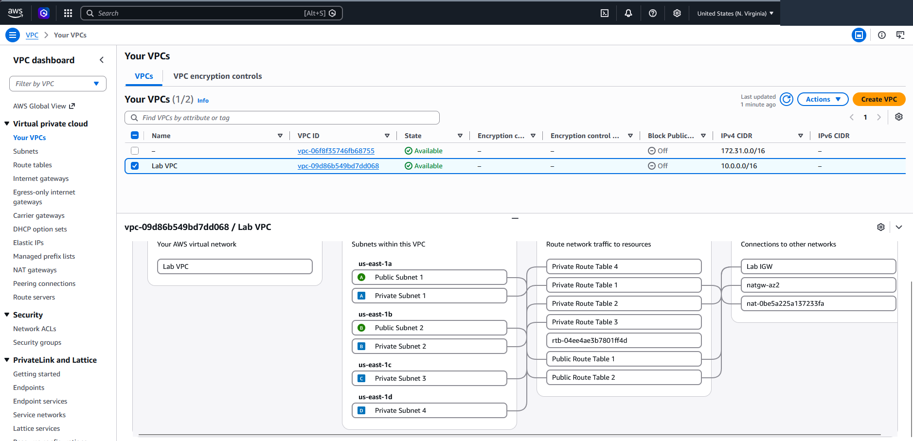
*E05 - VPC resource map after the change: second NAT gateway (natgw-az2) is attached to the network.*

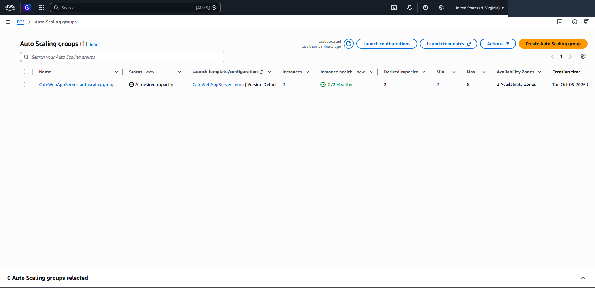
*E12 - Auto Scaling group at desired capacity: 2 instances, 2/2 healthy.*

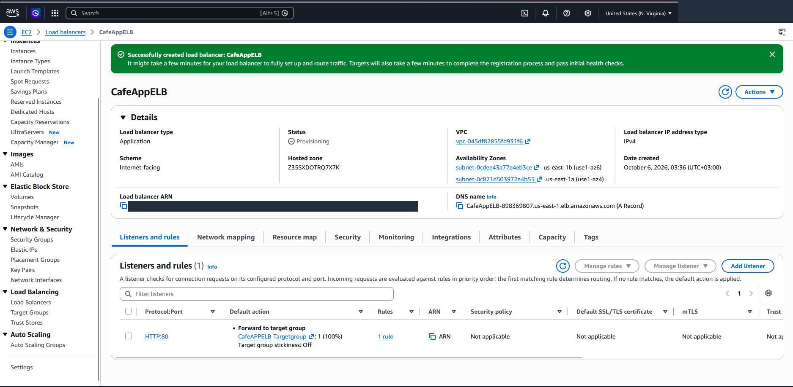
*E18 - Application Load Balancer CafeAppELB created, internet-facing, across two AZs, HTTP:80 listener forwarding to the target group.*

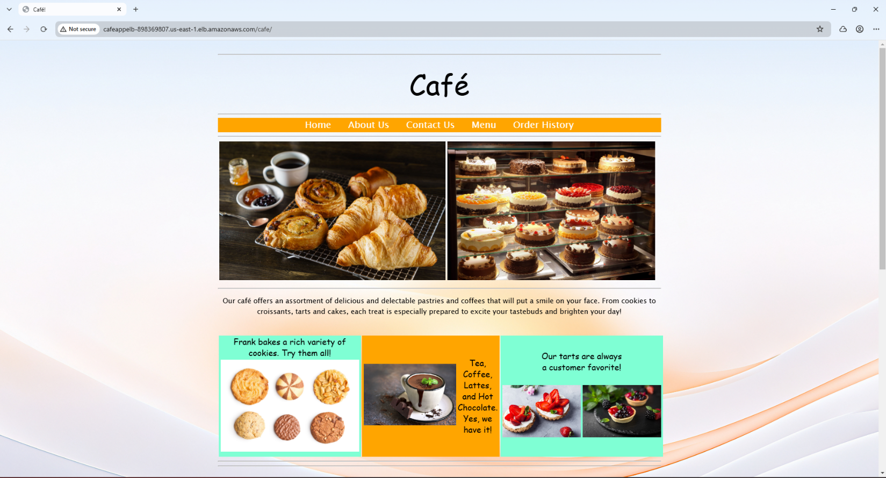
*E19 - Café web application loading through the load balancer DNS name at /cafe.*

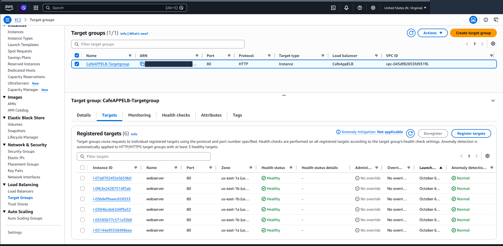
*E22 - Target group with six registered targets, all healthy.*

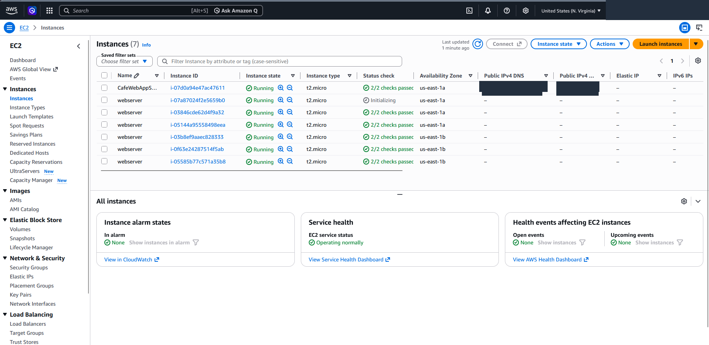
*E23 - EC2 console after scale-out: six "webserver" instances running across us-east-1a and us-east-1b.*

### Evidence index (all screenshots)

| ID | What it shows | File |
|---|---|---|
| E01 | Lab VPC resource map before any change: 4 private subnets, public subnets in two AZs, one NAT gateway. | `evidence/v5/V5-E01-vpc-resource-map-initial.png` |
| E02 | Creating a zonal NAT gateway (natgw-az2) in Public Subnet 2 with its own Elastic IP. | `evidence/v5/V5-E02-create-nat-gateway-az2.png` |
| E03 | Private Route Table 2 before the change: only the local route. | `evidence/v5/V5-E03-private-route-table-2-local-only.png` |
| E04 | Private Route Table 2 after adding 0.0.0.0/0 pointing to the new NAT gateway. | `evidence/v5/V5-E04-private-route-to-nat-az2.png` |
| E05 | VPC resource map after the change: second NAT gateway (natgw-az2) is attached to the network. | `evidence/v5/V5-E05-vpc-resource-map-with-nat-az2.png` |
| E06 | The Cafe WebServer Image AMI is available (created from the café web server during lab setup). | `evidence/v5/V5-E06-cafe-webserver-ami-available.png` |
| E07 | Launch template form: name, My AMIs, Cafe WebServer Image selected. | `evidence/v5/V5-E07-launch-template-config.png` |
| E08 | Launch template CafeWebAppServer-temp created successfully. | `evidence/v5/V5-E08-launch-template-created.png` |
| E09 | Launch templates list and details (version 1, default). | `evidence/v5/V5-E09-launch-template-details.png` |
| E10 | Create Auto Scaling group: name and launch template selected (t2.micro, key pair, security group). | `evidence/v5/V5-E10-create-asg-select-template.png` |
| E11 | Auto Scaling group created: desired 2, min 2, max 6, two Availability Zones, capacity updating. | `evidence/v5/V5-E11-asg-updating-capacity.png` |
| E12 | Auto Scaling group at desired capacity: 2 instances, 2/2 healthy. | `evidence/v5/V5-E12-asg-at-desired-capacity.png` |
| E13 | EC2 console: two new "webserver" instances launching, one in us-east-1a and one in us-east-1b. | `evidence/v5/V5-E13-asg-instances-launching-two-az.png` |
| E14 | Creating the new security group for the load balancer (inbound HTTP from anywhere). | `evidence/v5/V5-E14-create-alb-security-group.png` |
| E15 | Security group CafeAPPELBallowHTTP created: one inbound rule, HTTP port 80. | `evidence/v5/V5-E15-alb-security-group-http-rule.png` |
| E16 | Creating the target group: instance targets, HTTP port 80. | `evidence/v5/V5-E16-create-target-group.png` |
| E17 | Target group CafeAPPELB-Targetgroup created, no targets registered yet. | `evidence/v5/V5-E17-target-group-created-empty.png` |
| E18 | Application Load Balancer CafeAppELB created, internet-facing, across two AZs, HTTP:80 listener forwarding to the target group. | `evidence/v5/V5-E18-alb-created-listener-http80.png` |
| E19 | Café web application loading through the load balancer DNS name at /cafe. | `evidence/v5/V5-E19-cafe-website-via-alb-dns.png` |
| E20 | Session Manager session on a web server: installing the stress tool and starting the CPU test. | `evidence/v5/V5-E20-install-stress-tool.png` |
| E21 | top output during the test: the stress process is using about 100% of one CPU. | `evidence/v5/V5-E21-stress-cpu-load-top.png` |
| E22 | Target group with six registered targets, all healthy. | `evidence/v5/V5-E22-target-group-six-healthy-targets.png` |
| E23 | EC2 console after scale-out: six "webserver" instances running across us-east-1a and us-east-1b. | `evidence/v5/V5-E23-instances-scaled-out-six-webservers.png` |

<b>More evidence (all screenshots, in lab order)</b>

#### Task 1 - Inspect the environment

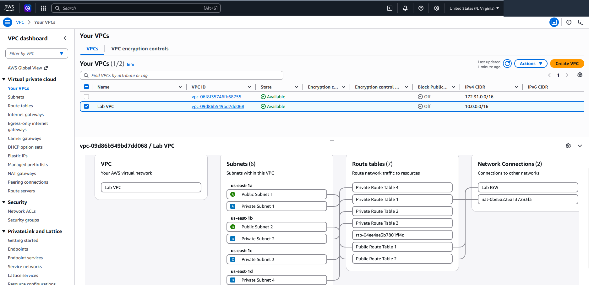
*E01 - Lab VPC resource map before any change: 4 private subnets, public subnets in two AZs, one NAT gateway.*

#### Task 2 - Second NAT gateway

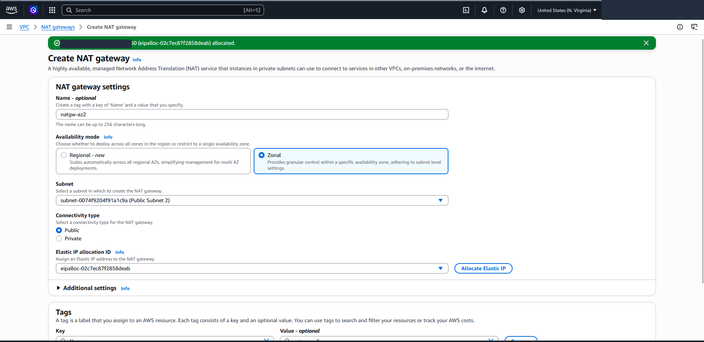
*E02 - Creating a zonal NAT gateway (natgw-az2) in Public Subnet 2 with its own Elastic IP.*

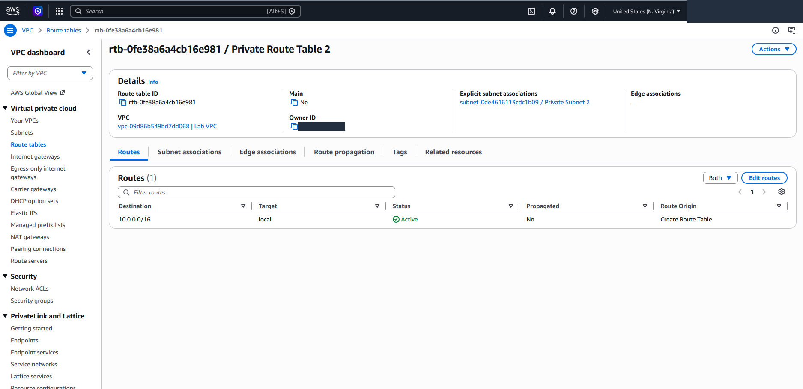
*E03 - Private Route Table 2 before the change: only the local route.*

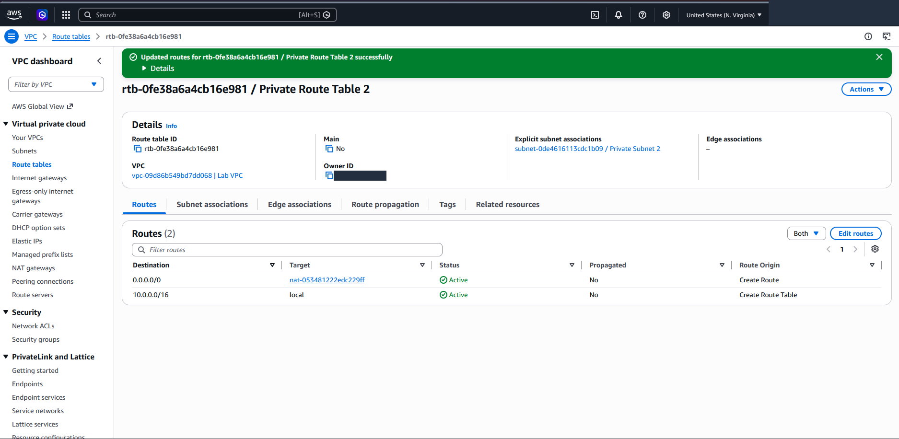
*E04 - Private Route Table 2 after adding 0.0.0.0/0 pointing to the new NAT gateway.*

*E05 - VPC resource map after the change: second NAT gateway (natgw-az2) is attached to the network.*

#### Task 3 - Launch template

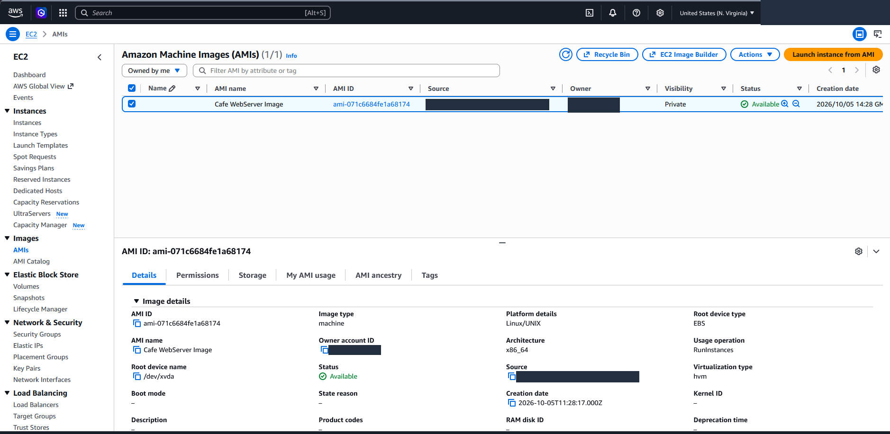
*E06 - The Cafe WebServer Image AMI is available (created from the café web server during lab setup).*

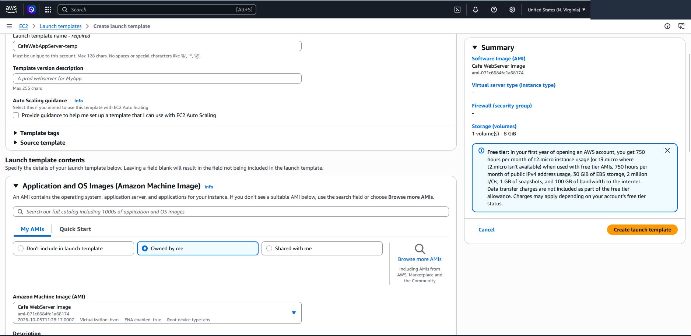
*E07 - Launch template form: name, My AMIs, Cafe WebServer Image selected.*

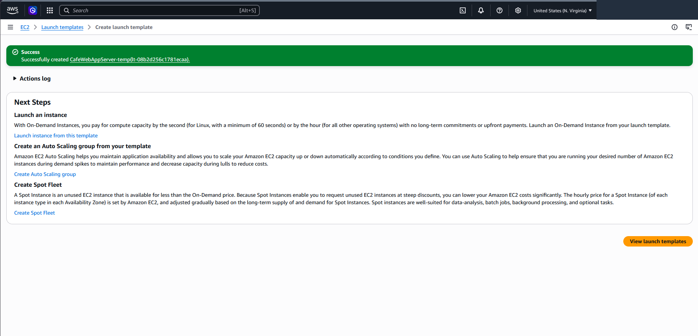
*E08 - Launch template CafeWebAppServer-temp created successfully.*

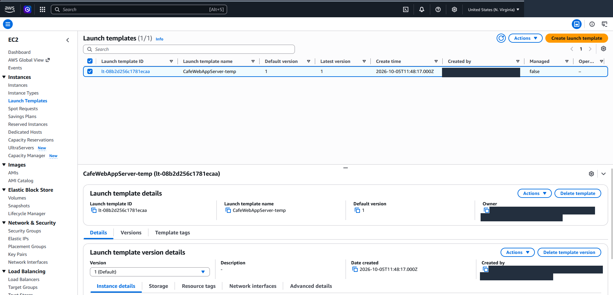
*E09 - Launch templates list and details (version 1, default).*

#### Task 4 - Auto Scaling group

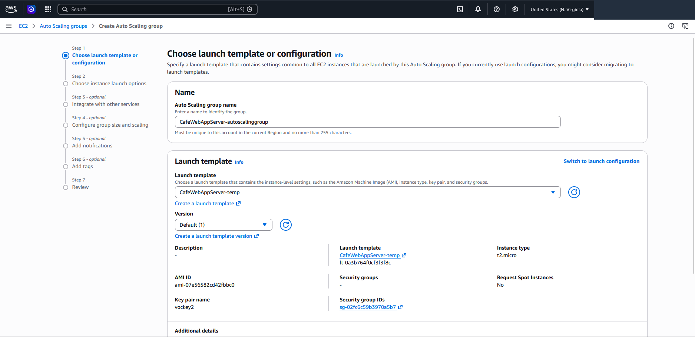
*E10 - Create Auto Scaling group: name and launch template selected (t2.micro, key pair, security group).*

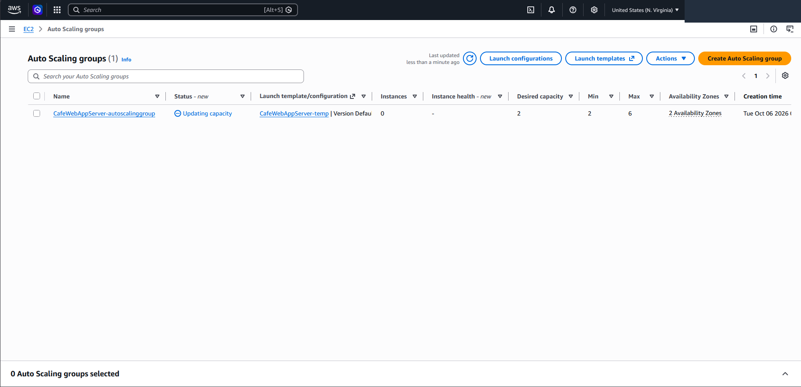
*E11 - Auto Scaling group created: desired 2, min 2, max 6, two Availability Zones, capacity updating.*

*E12 - Auto Scaling group at desired capacity: 2 instances, 2/2 healthy.*

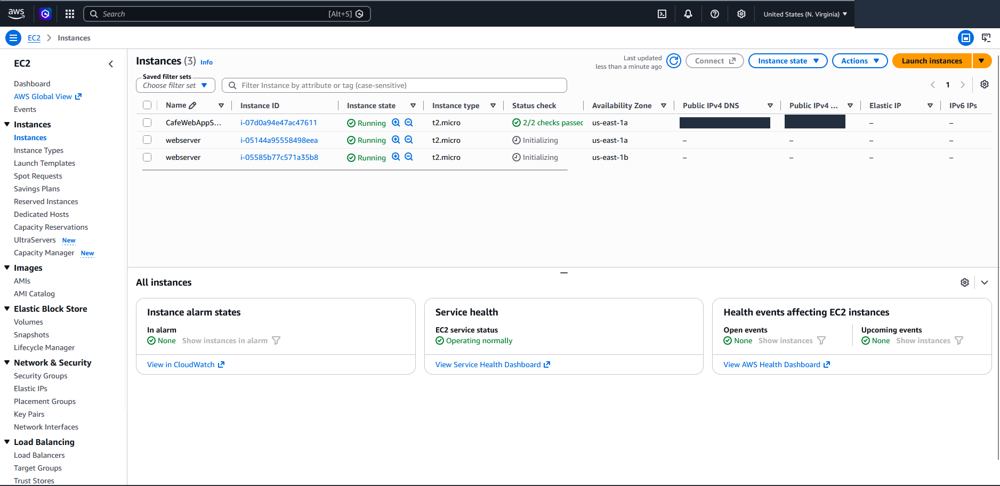
*E13 - EC2 console: two new "webserver" instances launching, one in us-east-1a and one in us-east-1b.*

#### Task 5 - Load balancer

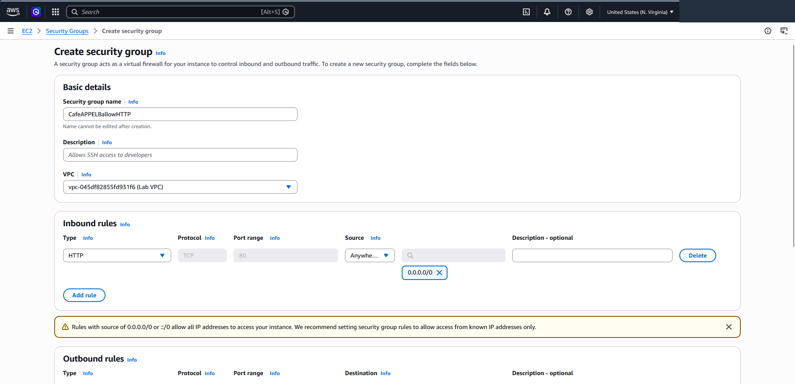
*E14 - Creating the new security group for the load balancer (inbound HTTP from anywhere).*

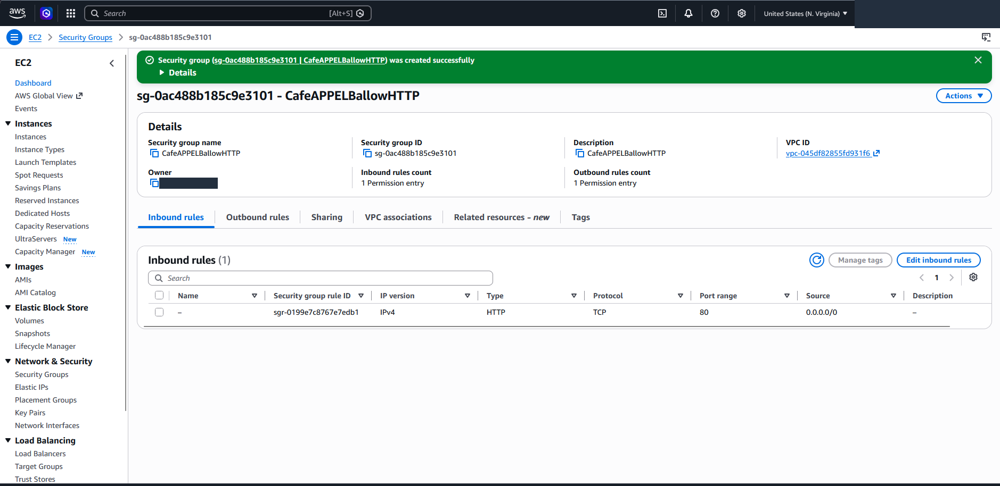
*E15 - Security group CafeAPPELBallowHTTP created: one inbound rule, HTTP port 80.*

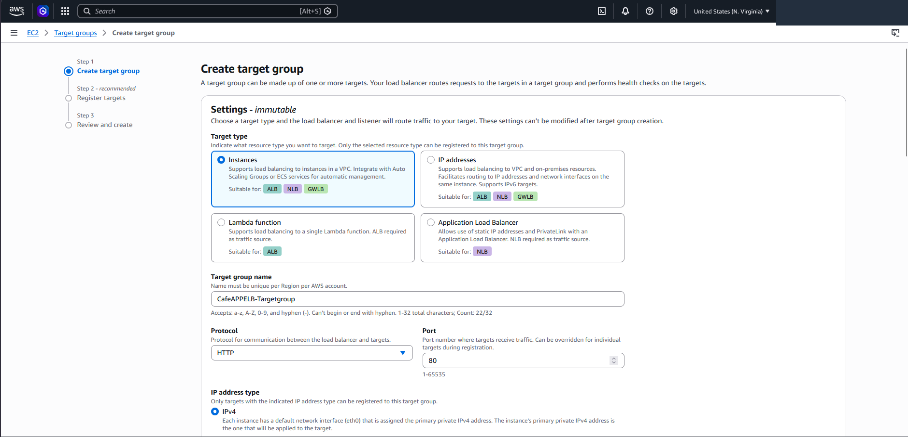
*E16 - Creating the target group: instance targets, HTTP port 80.*

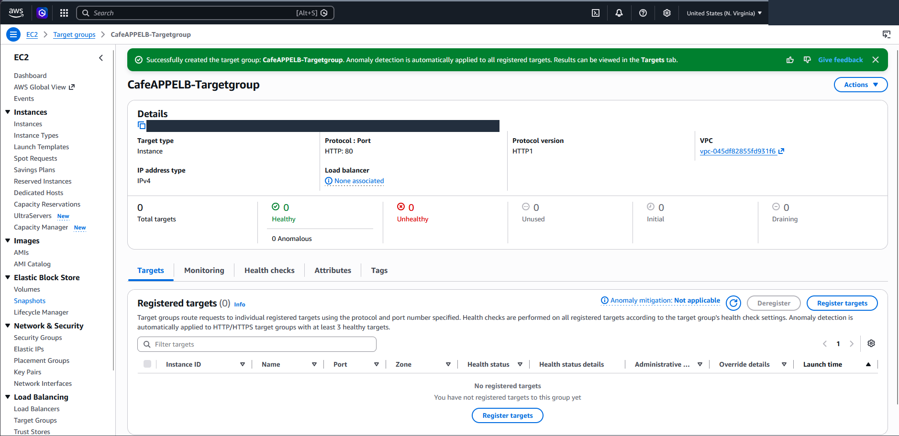
*E17 - Target group CafeAPPELB-Targetgroup created, no targets registered yet.*

*E18 - Application Load Balancer CafeAppELB created, internet-facing, across two AZs, HTTP:80 listener forwarding to the target group.*

#### Task 6 - Testing load balancing and scaling

*E19 - Café web application loading through the load balancer DNS name at /cafe.*

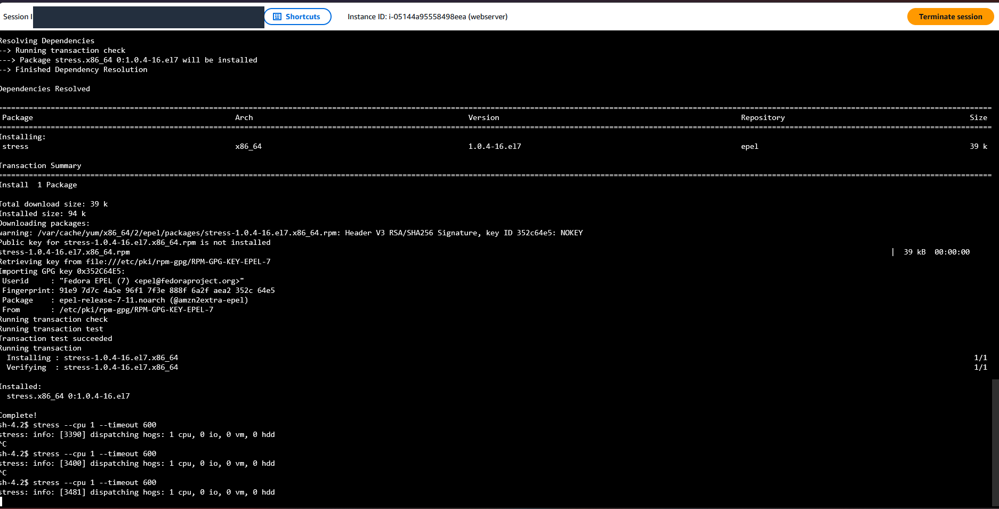
*E20 - Session Manager session on a web server: installing the stress tool and starting the CPU test.*

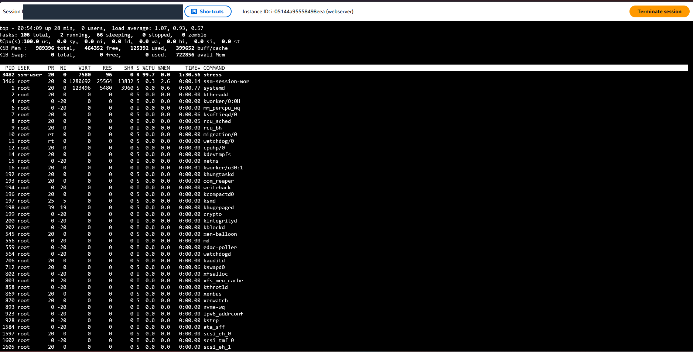
*E21 - top output during the test: the stress process is using about 100% of one CPU.*

*E22 - Target group with six registered targets, all healthy.*

*E23 - EC2 console after scale-out: six "webserver" instances running across us-east-1a and us-east-1b.*

> Evidence note: the screenshots come from more than one lab session (the Lab VPC ID is not the same in E01-E05 as in E14-E18). Account details and public IPs were masked.

## Outcome

The café website now runs behind an Application Load Balancer on an Auto Scaling group spread over two Availability Zones. Under a CPU stress test the group grew from 2 to 6 healthy web servers behind the load balancer without any manual action.

---

Previous: [V4 - Secure VPC Networking](v4-secure-vpc.md) | Next: [V6 - Infrastructure Automation](v6-iac-automation.md)
